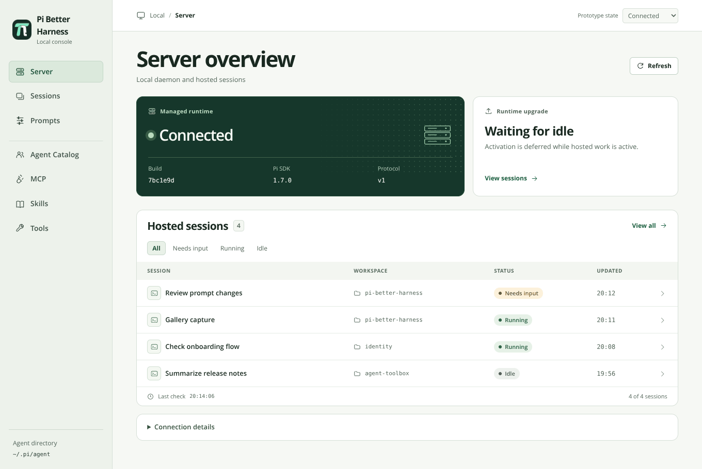
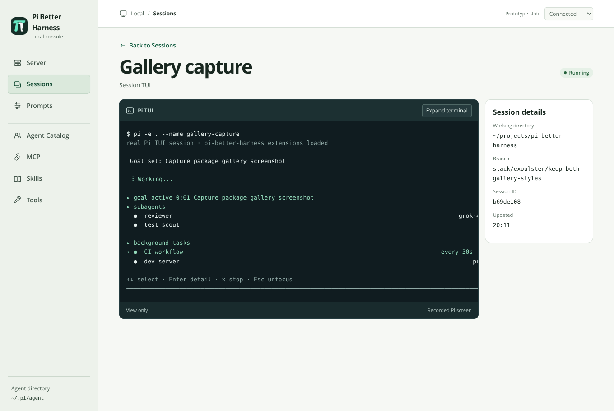
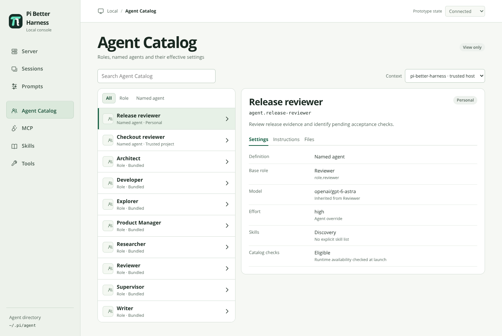

# Pi Better Harness 本地控制台

用户从总览确认当前 agent 目录运行的 build、哪几个托管会话正在工作、升级为何尚未生效。从列表进入会话即可看到 TUI。Agent Catalog、MCP、Skills、Tools 提供只读检查。界面沿用现有英文产品术语，以及 Pi Better Harness 的标志、薄荷绿和炭色。对应决策见 [ADR 0023](../../adr/0023-unified-server-runtime.md#本地-web-管理页)。

[Prompt Manager 四页设计稿](prompt-manager.md)覆盖编辑、变更审阅、单条响应回放和用例集评估。本文中的会话和目录画面使用示例数据。仓库保留[早期交互原型](index.html)供走查 Server 启动、刷新与筛选，新增页面以本文的静态设计稿为准。

## 页面与操作

| 入口 | 用户先看到什么 | 用户下一步能做什么 |
| --- | --- | --- |
| Server 总览 | 当前目录、daemon 状态及运行中的 build、Pi SDK 和协议；升级卡显示观测到的延期原因 | 刷新观测，查看会话，展开连接详情；确认已停止时可显式启动 |
| Sessions | 按完整工作目录分组的托管会话，显示名字、活动状态和更新时间 | 用 Needs input 筛选，打开独立详情页，直接看到 TUI 与当前问题。返回后恢复列表和筛选。 |
| Prompts | 同一 agent 目录的 Bundled 与 User 模块 | 打开候选工作区，编辑 User 模块、切换 Bundled 模块，审阅变更并从同一版本进入 Replay 或 Evaluate。参见[四个页面](prompt-manager.md) |
| 会话详情 | 中央终端屏幕；右侧为名称、工作目录、分支、session ID 和待答问题 | 打开即查看，支持扩大终端；返回列表释放观察，不取得输入控制权 |
| Agent Catalog | Roles、Named agents、来源及宿主作用域 | 搜索并筛选；打开 Settings、Instructions、Files，查看有效值是角色默认还是 agent override |
| MCP | 宿主报告的 MCP server、配置来源、连接状态 | 搜索和查看脱敏元数据。已配置和已连接分别显示 |
| Skills | 可发现的技能名称、说明、来源路径与作用域 | 搜索，按 Personal / Trusted project 筛选，查看发现状态。只有会话另有证据时才显示已读取 |
| Tools | 当前会话注册的工具，与其中 active 的子集 | 搜索、按 Active / Registered only 筛选、查看提供方和说明 |

总览的首屏保留状态卡和会话列表。列表优先展示待答、运行和空闲的会话；同组按最近活动排序。Sessions 使用完整目录分组，以便区分同名项目。较窄的窗口将导航移至顶部、状态卡纵向排列，保留名称和状态，路径与时间可在详情中查看。所有状态都有文字，键盘可以操作导航、筛选、启动及详情。

## 会话详情与 TUI

目标路由 `#sessions/b69de108` 直接打开 Gallery capture。画面使用仓库已有的[真实 Pi 终端采集](../../images/package-gallery/real-session/pi-better-harness.txt)；其他会话使用各自的设计示例画面。终端底栏注明 Recorded 或 Simulated。窄屏保留终端的行列布局，允许横向滚动，辅助资料移到其下。

正式实现要为选中会话提供实时 screen / PTY 观察：首帧可见，后续帧更新光标、字符与重绘，重新连接回到同一 session。若已有可观察 TUI，镜像其画面；纯托管会话需要能附着到同一会话的只读 TUI 视图。终端不可用时说明原因，不把缓存日志当作在线 TUI。现有 [companion](../../../packages/pi-better-server/src/companion.ts) 的启动等待取得 controller lease，不能直接充当自动的只读观察入口。生产验收要覆盖已有控制者、新输出及重绘、断连重连和退出观察，核对控制权、会话和源终端尺寸不受观察窗口影响。

## 只读目录

[Agent Catalog](agent-catalog.webp) 复用 `/agents` 的语义。左侧搜索角色及命名 Agent，右侧可查看有效设置、合并后的指令、文件与来源。示例中 Release reviewer 继承 Reviewer 的模型，单独覆盖 effort。个人、可信项目与内置定义按现有规则解析；页面只允许选择宿主已验证的上下文。角色内的执行限制不能给会话授予权限。[Catalog 操作与宿主授权](../../../packages/pi-better-subagents/docs/agent-catalog-operations.md)

[MCP 页面](mcp.webp)、[Skills 页面](skills.webp)、[Tools 页面](tools.webp) 复用相同的只读列表与详情布局，各自使用宿主快照。MCP 的连接状态需要 MCP 提供方证据；Skills 的发现不能证明技能正文已读；工具注册、会话启用与执行授权是三个不同事实。图中数据为示例。产品中适配器能力缺失或授权被撤销时清空该作用域的内容并显示“不可用”。这些页面只有查询和本地筛选；接口不提供配置、安装、连接或调用动作。[技能暴露约定](../../../packages/pi-better-subagents/docs/adr/0005-catalog-skill-exposure.md)

## 连接与升级的显示规则

| 观测结果 | 显示 | 页面操作 |
| --- | --- | --- |
| 新鲜且兼容的握手 | Connected，显示实际 build、SDK、协议和 daemon 实例 | Refresh、会话与升级详情 |
| 启动层确认无活动所有者且已停止 | Stopped，会话与升级状态暂不可用 | Start server 调用同一 managed ensure。等待期间显示 Starting，再次握手后才显示 Connected |
| 超时、socket 暂不可达或所有者身份不明 | Unknown，显示最近观测时间和具体原因；不把不可观测的列表算成零个会话 | Retry observation。重新连接成功前不提供启动操作 |
| 协议不兼容 | Incompatible，显示握手差异；需要时标明旧数据的时间 | Retry observation；本地 Prompts 仍可使用 |
| 已连接但升级等待中 | 在 Runtime upgrade 区域显示 activation journal 的阶段和 blocker。示意图采用 “Waiting for idle” | 只有 blocker 与具体会话身份匹配才直达该会话，否则进入会话列表 |
| 已连接且没有升级记录、能力不可用或读取失败 | 分别显示 “No upgrade recorded”、“Unavailable” 或错误原因 | 保持已取得的连接状态和会话信息 |

## 数据归属

- `hello` 提供当前进程的身份、协议、构建与 SDK 信息。页面只显示可用字段。启动探测与显式 `ensure` 复用管理启动路径。[握手和协议](../../../packages/pi-better-server/src/protocol.ts) · [启动入口](../../../packages/pi-better-server/src/cli.ts)
- `list_sessions` 提供托管会话的 ID、cwd、活动、待答问题及更新时间。Needs input、Running、Idle 为展示标签，优先识别待答对话。未托管的轻量客户端不在这份会话清单里。[会话语义](../../../packages/pi-better-server/README.md#protocol)
- `runtime_upgrade_status` 返回升级日志与 blockers。页面不根据会话列表推测升级原因。[状态读取](../../../packages/pi-better-server/src/server.ts)
- Prompts 复用已选 agent 目录、现有模块权限和显式 capture 连接。总览页不触发回放、模型请求或 prompt 更改。[ADR 0033](../../adr/0033-modular-prompts-and-replay.md)

## 设计验收场景

1. 在 Connected 场景核对 build 和升级原因，筛选 Needs input，打开 “Review prompt changes”，阅读具体问题，核对终端首屏与问题，再用 Back 返回。
2. 切到 Stopped，先刷新再进入 Prompts 的 Edit。回到 Server，仍应是 Stopped。点击 Start server 后经过 Starting 到 Connected。
3. 切到 Unknown，点击 Retry observation；确认页面没有启动动作。切到 Incompatible 验证协议差异与本地 Prompts 的可用性。
4. 在窄屏及仅用键盘重复上述导航。正式实现另用真实 daemon 验证被动观测不启动服务、不创建会话、不延长空闲生命周期。
5. 打开 Agent Catalog，查看 Release reviewer 的继承、指令和来源；切换到 Personal host 确认项目条目退出视图。依次进入 MCP、Skills 和 Tools，确认仅能查看。在无快照的演示宿主上应显示不可用。
