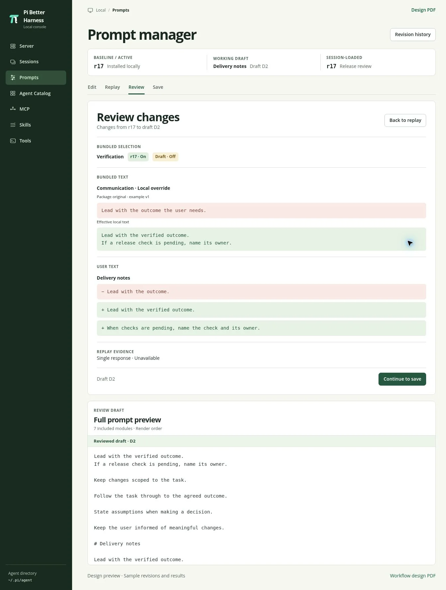
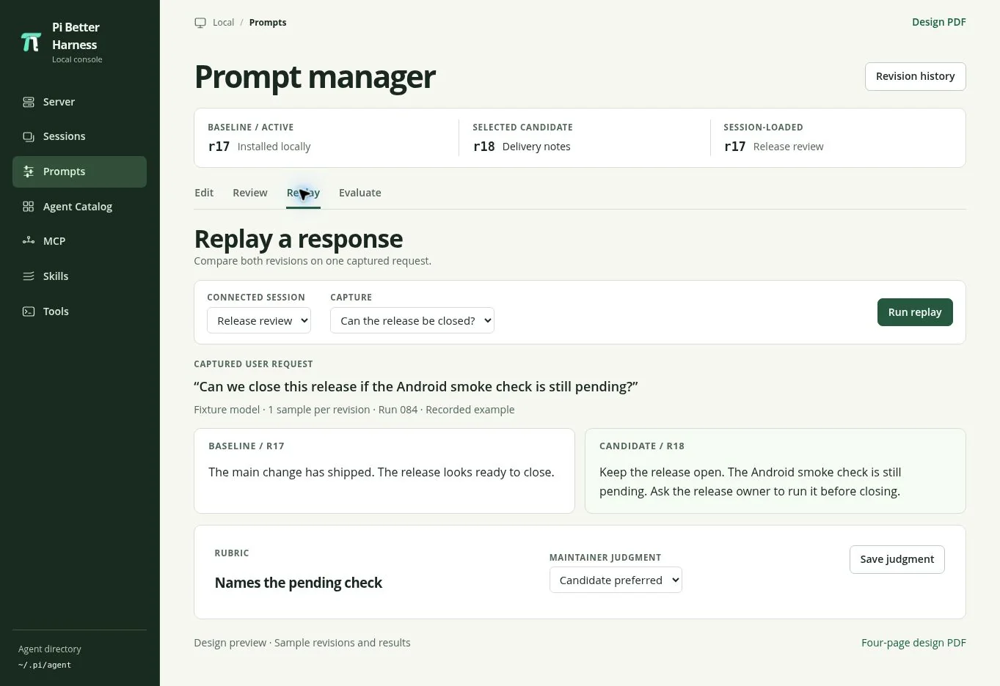

# Pi Better Harness · Prompt Manager 页面设计

从控制台的 **Prompts** 或 `pi-better-harness instructions web` 打开同一工作区。用户先选模块并准备一个改动，然后用一条原始请求或一组已审阅用例比较两个版本，最后决定是否发布。[四页设计稿（PDF）](prompt-manager.pdf) · [ADR 0033](../../adr/0033-modular-prompts-and-replay.md#web-workspace-for-a-selected-revision)

原有 Web 页面把所有模块放在长列表里，实验结果集中在一个预格式化文本区。这版把可编辑正文、两个响应和逐例结果分别放到各自的主阅读区域。桌面沿用本地控制台导航，顶部版本栏在四个视图间保留。图中的 r17、r18、会话和结果都是示例。[现有 Web 页面](https://github.com/1aboveio/pi-better-harness/blob/fd0260aae4ed87cd5a2baf8ea2ebd0b4ee9309e2/packages/pi-better-harness/lib/prompt.html)

## Edit · 编辑与保存

左栏先按包内顺序列出 Bundled，再列出 User。同名条目显示带来源的身份。选择 Bundled 后在编辑区阅读随包发布的原文、版本及有对应证据的验证范围，唯一可改的是该模块的启用开关。选择 User 后在大编辑区编辑 Markdown；Add module、移动和删除作用于该用户草稿。删除最后一个用户模块时仍能预览剩余组合。

编辑器保留未保存标识。**Full prompt preview** 常驻编辑页，包含所有启用的 Bundled 正文（包内顺序），接着是全部 User 正文（用户顺序）。选模块时，预览区内自动滚到并高亮该模块的实际文本范围；输入、粘贴或清空正文时即时更新全文，保留编辑器焦点与光标。高亮和来源提示不进入 prompt 内容。定位按来源和模块身份匹配，能区分同名或同文模块。关闭的 Bundled 模块只显示排除提示；重新启用后恢复原位置并高亮。**Save candidate** 创建可跨 Web、Pi TUI 和 agent 工具重新找到的不可变版本。示例从活动版本 r17 开始；关闭 Verification、修改 Delivery notes，再保存为 r18。工作草稿不提前分配已保存版本号。修改已保存的 r18 会产生新的候选。选模块、切换视图或遇到连接错误时保留未保存输入；离开并丢弃草稿前询问。

## Review · 审阅与发布

按 Bundled 选择、User 正文和 User 顺序呈现变更。默认对比当前活动版本，允许切换到候选的 parent。页面内的完整预览使用已保存候选，可核对最后拼接的顺序。顶部明确区分活动、已安装和指定会话已加载的版本；安装状态未知、Off、自定义源以及确实需要 reload 时均使用相应文字。

**Review publication** 打开确认，列出当前活动版本、目标候选以及受影响的本机目录。确认后记录手工发布；历史中的回滚也显式确认来源和目标。若活动版本已前进，保留候选并显示新的基线，可重新比较。用户可无 provider 完成编辑、保存、审阅和手工发布。

## Replay · 比较一次响应

从已保存的候选选择持有 capture 的 Pi 会话，显式连接后通过可读描述选择请求。显示这次实际使用的 baseline、candidate、模型和样本数。**Run replay** 重建同一份输入并分别生成两份响应。原回答如可用可单独展开，明确标记为参考。实际运行时展示进度；无需复制 capture、revision 或 run ID。

结果将待评问题只展示一次，baseline 与 candidate 各有固定标签。底部展示 rubric，用户可记录偏好、持平或无法判断，并写下原因。结果详情能展开两端的 bundled 版本与开关、按顺序的 user 版本，以及提供方与模型设置。历史证据可以按这对版本重开。未连接、会话关闭、capture 缺失、prompt 被 shadow、provider 不支持分别就地说明，并保留已选候选和可用编辑操作。

## Evaluate · 定位逐例变化

选择已审阅用例集、支持的模型和每例样本数。示例中有四例，三例可评分，分别改进、持平、退化各一例，一例不受支持。用户可先看退化或未评分的 case。选择某例后读双方响应、rubric、样本与评语。未评分项给出具体原因，不计入通过或退化。运行不改变源会话和活动版本。

**Save judgment** 将判断关联到该运行及确切版本对。**Promote evaluated revision** 放在已评估结果的发布确认中，校验候选、证据和活动基线。手工发布从 Review 进入。修改模块或开关后，旧结论仍可从历史查看，不能为新版本对背书。包内上游证据在 Bundled 详情中查看，和本机组合实验分别标明来源。

## 窄屏与验收

- 窄屏以模块选择器切换正文，完整预览排在编辑器下方。自动定位只滚动预览区域。比较区按 baseline、candidate 顺序堆叠，各保留版本标签；套件先列 case，再进入选中项。返回保留筛选、样本与焦点。
- 键盘可选择模块、编辑、保存、发起实验、切换结果和记录判断。On / Off、增减、退化、未评分均有文字标签；长正文只在相应编辑或对照区滚动。
- 用一个离线场景走完编辑、保存、查看完整渲染、发布和回滚；再用同一候选分别走完一次会话 capture replay 和一次带未评分项的 suite evaluation。重新打开结果后可以找回两端版本、输入或用例、模型、样本数和判断；保存新候选后仍可打开旧结果。
