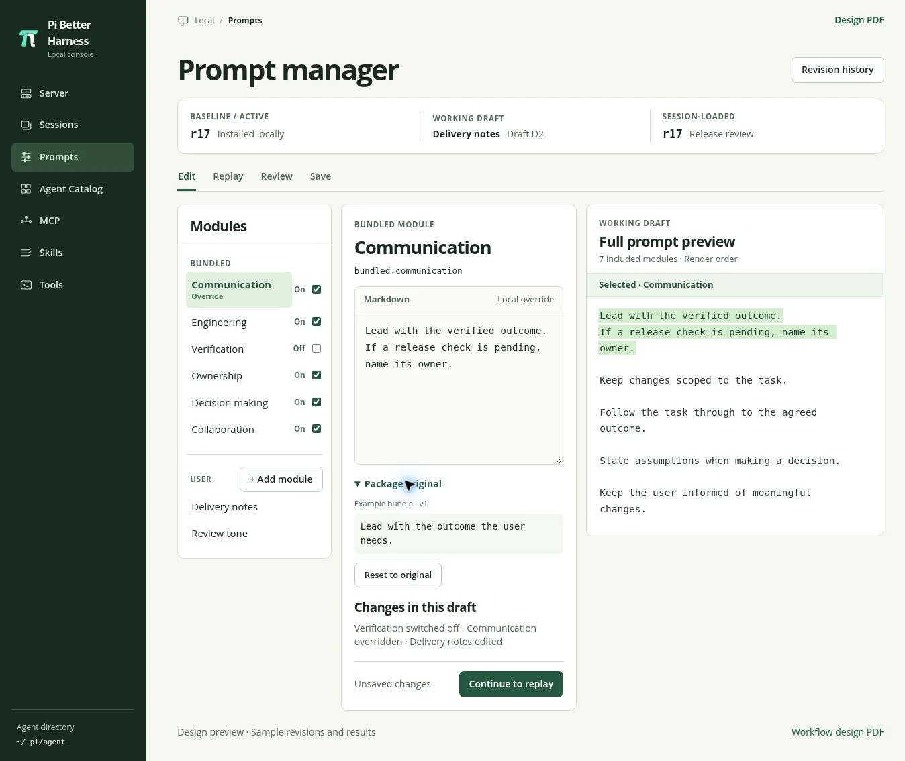
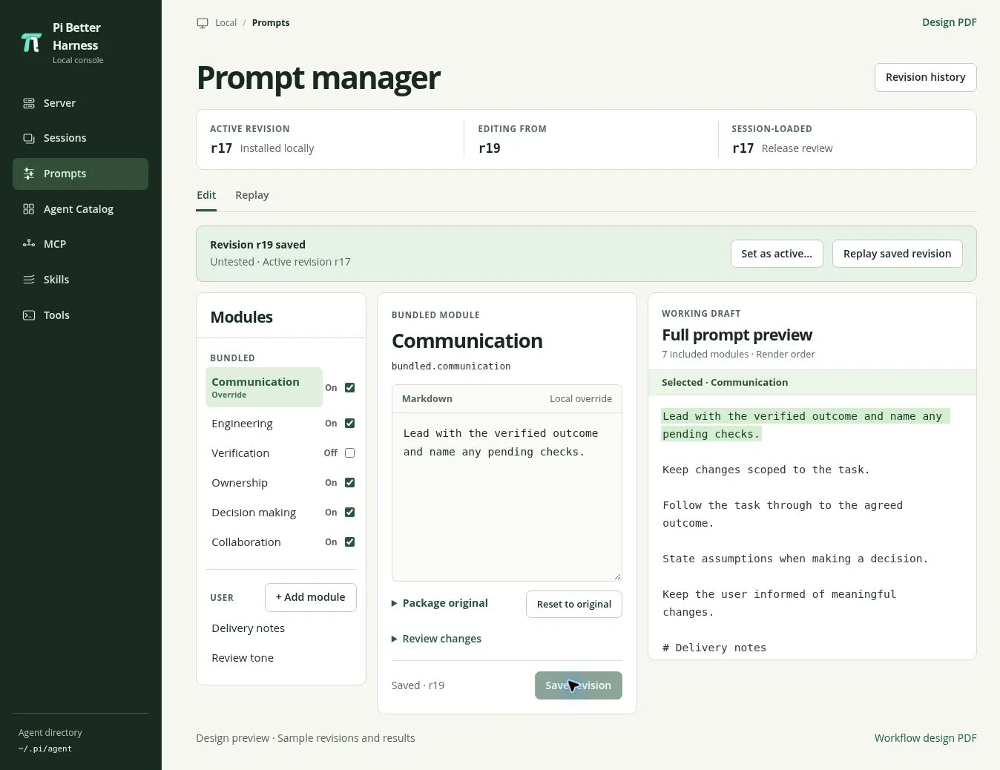

# Pi Better Harness · Prompt Manager 页面设计

从控制台的 **Prompts** 或 `pi-better-harness instructions web` 打开同一工作区。用户先选模块并准备一个改动，然后用一条原始请求或一组已审阅用例比较两个版本，再审阅差异，最后保存一个版本。主导航为 **Edit → Replay → Review → Save**。[工作流程设计稿（PDF）](prompt-manager.pdf) · [ADR 0033](../../adr/0033-modular-prompts-and-replay.md#web-workspace-for-a-selected-revision)

原有 Web 页面把所有模块放在长列表里，实验结果集中在一个预格式化文本区。这版把可编辑正文、两个响应和逐例结果分别放到各自的主阅读区域。桌面沿用本地控制台导航，顶部版本栏在四个视图间保留。图中的 r17、r18、会话和结果都是示例。[现有 Web 页面](https://github.com/1aboveio/pi-better-harness/blob/fd0260aae4ed87cd5a2baf8ea2ebd0b4ee9309e2/packages/pi-better-harness/lib/prompt.html)

## Edit · 编辑与保存

左栏先按包内顺序列出 Bundled，再列出 User。同名条目显示带来源的身份。选择 Bundled 后可以直接编辑当前有效 Markdown。第一次修改即显示 **Local override**，模块保留原槽位和顺序。展开 **Package original** 可对照该版本随包发布的原文；**Reset to original** 仅移除当前模块的本地覆盖，立即恢复该草稿所用包版本的原文。启用开关独立：关闭时保留覆盖，重新打开继续使用覆盖；关闭时 Reset 也不会开启模块。包的验证记录始终指向原文。选择 User 后在大编辑区编辑 Markdown；Add module、移动和删除作用于该用户草稿。删除最后一个用户模块时仍能预览剩余组合。

编辑器保留未保存标识。**Full prompt preview** 常驻编辑页，包含所有启用的 Bundled 模块的有效正文（有覆盖取覆盖，否则取包原文，按包内顺序），接着是全部 User 正文（用户顺序）。选模块时，预览区内自动滚到并高亮该模块的实际文本范围；输入、粘贴或清空正文时即时更新全文，保留编辑器焦点与光标。高亮和来源提示不进入 prompt 内容。定位按来源和模块身份匹配，能区分同名或同文模块。关闭的 Bundled 模块只显示排除提示；重新启用后恢复原位置并高亮。**Continue to replay** 携带现有草稿，无需先保存。示例从已有 r18 继续编辑 Communication。Review 展示包原文和本地文本，最后在 Save 才生成新版本。工作草稿不提前分配已保存版本号。修改已保存的 r18 会产生新的候选。选模块、切换视图或遇到连接错误时保留未保存输入；离开并丢弃草稿前询问。

## Replay · 选择一次对比的范围

**Single response** 适合检查引发修改的那条请求；**Case suite** 适合确认修改对其他案例的影响。一次可以只选一种，也可以用同一草稿分别运行两种。

### Single response

从未保存的草稿或已重开的候选出发，选择持有 capture 的 Pi 会话，显式连接后通过可读描述选择请求。显示这次实际使用的 基线与草稿快照、模型和样本数。**Run replay** 重建同一份输入并分别生成两份响应。原回答如可用可单独展开，明确标记为参考。实际运行时展示进度；无需复制 capture、revision 或 run ID。

结果将待评问题只展示一次，baseline 与 candidate 各有固定标签。底部展示 rubric，用户可记录偏好、持平或无法判断，并写下原因。结果详情能展开两端的 bundled 原文版本、开关、覆盖及实际生效文本摘要、按顺序的 user 版本，以及提供方与模型设置。实验在运行时冻结实际输入。调整文字、开关或覆盖之后，旧实验仍属于原快照。未连接、会话关闭、capture 缺失、prompt 被 shadow、provider 不支持分别就地说明，并保留草稿和可用编辑操作。

### Case suite

选择已审阅用例集、支持的模型和每例样本数。示例中有四例，三例可评分，分别改进、持平、退化各一例，一例不受支持。用户可先看退化或未评分的 case。选择某例后读双方响应、rubric、样本与评语。未评分项给出具体原因，不计入通过或退化。运行不改变源会话和活动版本。

**Record judgment** 将判断关联到该运行及确切输入对。**Promote evaluated revision** 放在已评估结果的发布确认中，校验候选、证据和活动基线。保存后的版本可另行确认启用。修改模块或开关后，旧结论仍可从历史查看，不能为新版本对背书。包内上游证据在 Bundled 详情中查看，和本机组合实验分别标明来源。

## Review · 审阅变更和证据

分别列出 Bundled 开关、覆盖或恢复原文、User 正文和 User 顺序。恢复原文时可对照父版本中的覆盖与恢复后的包原文。默认对比当前活动版本，允许切换到候选的 parent。页面内的完整预览使用即将保存的草稿，可核对最后拼接的顺序。顶部明确区分活动、已安装和指定会话已加载的版本；安装状态未知、Off、自定义源以及确实需要 reload 时均使用相应文字。

同时显示 Replay 的结果和评语；无 provider、主动跳过、无法评分或结果已过时均明确标记。**Continue to save** 确认当前审阅对象。返回编辑后，重新审阅修改后的草稿。

## Save · 保存已审阅版本

**Save revision** 把刚才审阅的草稿保存为不可变的本地候选，关联匹配的回放结果。保存前可以返回 Review；保存后显示新版本号和当前活动版本。没有 provider 时可以显式跳过 Replay，Review 和 Save 均显示未验证状态。若用户希望让该版生效，可另行确认 **Set as active**；已打开的会话在 reload 后加载。活动基线冲突时保留候选，历史中仍可回滚。

## 窄屏与验收

- 窄屏以模块选择器切换正文，完整预览排在编辑器下方。自动定位只滚动预览区域。比较区按 baseline、candidate 顺序堆叠，各保留版本标签；套件先列 case，再进入选中项。返回保留筛选、样本与焦点。
- 键盘可选择模块、编辑、保存、发起实验、切换结果和记录判断。On / Off、增减、退化、未评分均有文字标签；长正文只在相应编辑或对照区滚动。
- 用一个离线场景走完编辑、跳过回放、审阅、保存、显式启用和回滚；再用同一候选分别走完一次会话 capture replay 和一次带未评分项的 suite evaluation。重新打开结果后可以找回两端版本、输入或用例、模型、样本数和判断；保存新候选后仍可打开旧结果。
