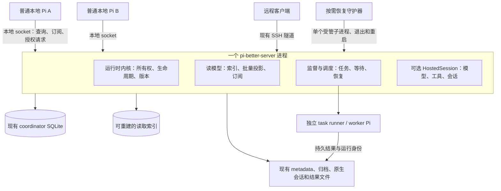
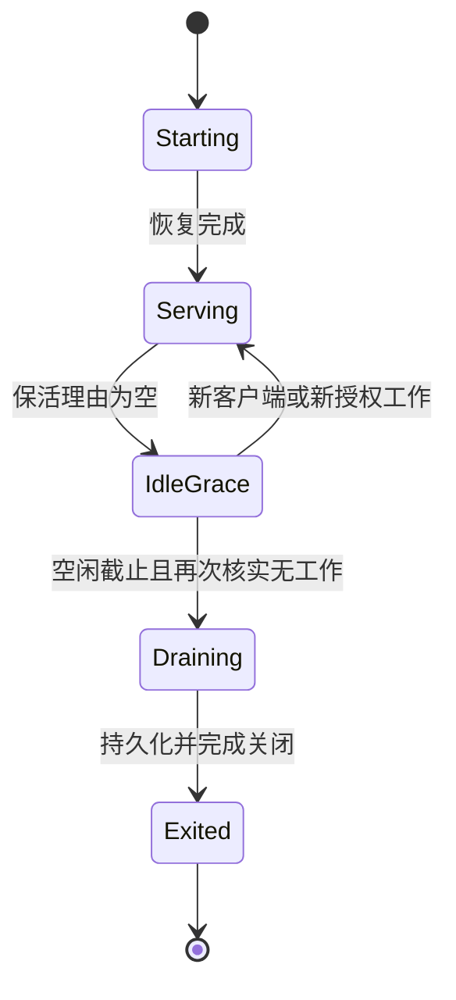

# 统一 Pi Server 运行时设计

## 1. 状态与结论

本文记录已接受、待实现的目标设计，覆盖 Subagents、Background Tasks、Agent Catalog 与 `pi-better-server` 的统一管理和进程生命周期。当前代码尚未具备本文描述的统一能力。本次文档不启动后台进程、不迁移数据、不改变任务权限或现有 server 配置。

建议扩展 `pi-better-server`，由同一个 server 进程承担共享状态读取、监督调度和可选的 Pi 会话托管，不再增加一个与 server 并行的 runtime daemon。server 内部拆分模块，但共享一个启动入口、实例所有权、通信端点、升级流程和退出判定。普通本地 Pi 可以只使用状态服务，不必把前台会话迁入 server。

关键决策见 [ADR 0023](../adr/0023-unified-server-runtime.md)。已确认的性能问题与复现证据见 [#747](https://github.com/1aboveio/pi-better-harness/issues/747) 和 [#749](https://github.com/1aboveio/pi-better-harness/issues/749)。

## 2. 问题与现有基础

### 2.1 已确认的问题

- `registry.listMetas()` 合并活动运行目录和完成归档。健康检查在取得完整结果后才过滤活动状态，维护成本随历史增长。
- 归档目录任意原子替换会使整个归档列表失效；不变查询仍逐条检查会话状态文件。多个 Pi 分别维护缓存，重复承担这些工作。
- 真实 Navigator provider 在过期过滤和行格式化中分别创建投影器。同一行被投影两次，每次可能读取元数据并打开 SQLite。
- 绘制快照修复了逐帧 I/O，但每秒刷新仍能产生大量 I/O。把缓存封装进一个进程内模块，无法消除跨进程重复工作。
- 局部性能测试没有约束完整 provider、健康检查、外部写入和多个前台进程叠加后的成本。

### 2.2 可复用的实现

| 现有模块 | 已有职责 | 本设计的处理 |
| --- | --- | --- |
| `pi-better-server/src/server.ts` | Unix socket、会话命令、维护与退出 | 作为唯一进程入口，加入运行时能力 |
| `daemon-owner.ts` | 发布完整 owner 记录、拒绝活实例并发启动 | 保留 token 语义，补齐跨平台身份与作用域检查 |
| `startup/*` | 固定构建、就绪检查、安全激活、升级恢复 | 扩展到共享工作，禁止在有任务时错误判定可升级 |
| `registry.ts` / `HostedSession` | 托管 AgentSession、会话恢复和写入所有权 | 继续负责托管会话，不收编普通前台会话 |
| `SessionActivity` | 工具、命令、扩展后台活动观测 | 消费统一活动快照，移除为判定空闲而重复全量查询 |
| Agent Catalog | Role、Named Agent、继承、持久偏好和会话覆盖 | 文件格式和解析规则保留，由 server 统一管理共享读取与持久修改 |
| `operation-coordinator` | waits、claims、取消 epoch、outbox、终态事务 | 保持既有业务事实来源，增加管理实例 fencing |
| `ObservedWaitHost` | 全局发现负责人、监督、回调、恢复 | 将机械执行部分迁入 server，客户端只保留会话交互 |
| 独立 task runner | 命令执行、日志、终态记录 | 保留独立进程和执行 token，不并入 server 事件循环 |
| Subagents | 会话历史、启动配方、writer proof、continuation admission | 保留领域规则，迁移机械管理位置 |

`operation-coordinator` 是共享存储库，不是独立管理进程。现有 Background Tasks 已有按 store/supervisor scope 选出的发现负责人，但 Subagents 归档、投影和前台刷新尚未统一。本文扩展现有正确性机制，不增加第二份等待或终态真相。

## 3. 目标与范围

目标：共享全局工作只执行一次；每个会话只处理自己的增量数据；关闭所有 Pi 后，无工作进程自动退出，有授权后台工作的进程继续提供监督；崩溃、重载、取消和升级不重复启动任务。

首版支持 macOS 与 Linux 的本机用户态运行时。每个远程主机分别运行自己的 server，继续复用现有 SSH 连接方式。Windows、网络文件系统上的跨主机共享 agent 目录、多个 UID 共用运行时均不在首版支持范围。

不改变 assignment 的五种领域状态，不引入 subagent 暂停/继续流程，不自动合并或发布代码，不把本地 Pi 自动迁移为远程会话，不以删除历史降低成本。Codex daemon 继续使用现有独立 engine profile，首版不接管 Pi 的任务或 coordinator。

## 4. 核心不变量

1. 一个 canonical Pi agent 目录只有一个有管理权限的 server 实例；多个前台或多个安装副本不能建立竞争实例。
2. SQLite 中已提交的 wait、claim、取消和 assignment outcome 仍为相应领域事实来源；读模型只提供查询结果。
3. 一个 conversation 最多有一个已证明的执行 writer。管理器替换不能使旧启动 token 重新有效。
4. 管理权限不等于执行授权。每次 launch、resume、cancel 都验证对象关系、当前权限、预期 revision 和精确 token。
5. 绘制、排序、格式化、过期过滤不做文件系统或数据库 I/O。
6. 重读、重连和重复通知不推进语义 revision，不重新消费结果，不创建额外模型轮次。
7. 已完成历史、未读结果、证据 pin、未知归属记录本身不构成永久保活理由。
8. 没有客户端、托管会话保留义务或可推进后台义务时，server 与恢复守护器都必须退出。
9. 状态不明不伪装为空列表、成功或已终止；不明 writer 保留执行隔离，不能借管理器重启绕过。

## 5. 进程与模块结构



正常基线最多增加两个进程：一个轻量恢复守护器和一个 server；任务 runner、worker Pi 与现有执行模型一致，按实际任务数量存在。守护器不扫描历史、不计算任务投影、不调用模型、不处理业务 RPC。它只持有启动所有权、观察直接子进程、执行有上限的故障重启，并与 server 共同退出。

选择守护器是为了覆盖「最后一个前台已退出，server 随后崩溃，但仍有授权后台工作」的恢复。仅靠下次启动 Pi 才恢复，会在此场景中断自动监督。首版不安装 login service、launchd agent 或 systemd user service，也不在注销或机器重启后自动复活。

server 的运行时能力按需激活。查询 Subagents 状态不会创建 HostedSession，不加载全部会话历史，也不启动模型。只有显式 create/open、已授权 continuation 或原有托管恢复才加载相应 AgentSession。server 内部模块共享 store 与调度器，不能因每个 HostedSession 加载一次扩展而各创建一套管理循环。

建议目录归属均在 `packages/pi-better-server` 内：`runtime/kernel` 管理实例和生命周期；`runtime/read-model` 管理快照及索引；`runtime/supervision` 管理机械协调；`runtime/client` 提供不依赖完整 Pi SDK 的轻量客户端；`runtime/guardian` 管理进程恢复。Subagents 的启动配方和权限规则通过固定版本内部模块调用，不由任意客户端上传执行代码。

## 6. 实例作用域、启动与单实例保证

### 6.1 作用域

运行时身份由当前 UID、canonical agent 目录和运行环境身份确定。路径别名通过 `realpath` 归一；未创建目录先安全创建后再解析。相同目录的 symlink 别名不能启动第二套实例。不同 agent 目录互相隔离。

这里的运行环境指本机执行环境，不包含安装路径、包版本、前台 PID 或重启次数。这些变化不能产生新的 root scope，从而绕过已有管理实例。重启身份用于核实进程，不改变同一 agent 目录的持久管理作用域。

现有 `PI_SERVER_DIR` 继续决定 transport 与 server 数据位置，但不能改变相同 agent 目录的管理唯一性。在 agent 目录发布一个 token 化的 server 注册记录，指向 canonical server 目录。不同 `PI_SERVER_DIR` 请求同一 agent 目录时复用已注册实例；不兼容则明确拒绝，不能悄悄另开一个 coordinator 管理者。迁移注册记录需要精确所有权和无竞争实例的证明。

### 6.2 按需启动流程

1. 客户端读取注册记录，尝试连接并做强制能力握手。已有活实例但不兼容或无响应时，返回明确错误。
2. 只有端点不存在且不存在活的或身份不明的 owner，才进入现有 managed-runtime 启动流程。启动超时不等于 owner 已死。
3. 竞争启动者通过原有完整目录发布机制竞争 guardian owner；胜出者启动一个 server 子进程，其余等待胜出实例就绪后退出。
4. guardian 与 server 使用独立角色记录。server 在读取托管会话索引、恢复 writer 或接收 mutation 之前取得当前 runtime epoch。
5. server 先发布协议与恢复状态，再完成有界活动状态恢复；大历史索引在后台分批构建。`hello` 成功不代表所有 scope 都已 ready。
6. 客户端在明确 scope ready 后才订阅权威快照或提交 mutation。启动保护窗口不被心跳无限续期。

现有 `daemon-owner` 在 Linux 使用 boot/start 身份，其他平台的 PID 检查更保守。实现阶段必须统一复用受测试的进程开始身份接口，补齐 macOS；身份无法确认时拒绝替换，不通过超时删除 owner。旧版本仍识别的 server owner 名称和语义必须保留，guardian 不能通过改锁名使旧版本绕过互斥。

### 6.3 防止旧实例继续写入

持久 `runtimeEpoch` 由取得管理权的新 server 在 coordinator 事务中递增。每个管理 mutation 携带 epoch，并在同一写事务中核验。通知携带 `instanceId` 和 epoch，客户端拒绝旧实例事件。

这不能单独隔离旧版本直接写文件。进入 managed 模式前，所有具备管理能力的写入方必须使用支持 epoch 的协议；发现旧活 supervisor 时，保持兼容观察状态，拒绝接管和自动执行。迁移不能声称靠新字段就隔离了不认识该字段的旧代码。

外部进程启动不与数据库原子提交。仍复用 attempt ID、launch token、checkpoint、writer lease 和 bootstrap 验证。spawn 前事务校验与 bootstrap 二次校验都需要当前 epoch；崩溃歧义窗口进入既有 reconciliation，不能生成新 token 重试。本文不承诺外部副作用恰好一次。

## 7. 统一事实来源与读取快照

### 7.1 权威划分

| 信息 | 权威位置 | 允许的读取模型行为 |
| --- | --- | --- |
| wait、取消、resume claim、assignment outcome、outbox | 现有 coordinator | 按 revision 读取，不另存竞争领域状态 |
| 运行配方、attempt 身份与原生会话 | 现有 Subagents 持久记录 | 索引检索位置，保留 lineage 与 workspace 关系 |
| 命令终态与执行证据 | 匹配 token 的 runner 结果 | 验证身份后导入，不从 PID 消失推断成功 |
| 托管会话开闭、迁移与 writer 归属 | 现有 server registry / ownership | 不因普通本地会话注册而创建托管 writer |
| Role、Named Agent 与持久模型偏好 | 现有 Markdown 定义与 catalog `settings.json` | 按配置来源索引和解析，不建立第二份可编辑定义 |
| 会话分支的 Catalog 临时设置 | 原会话分支的持久 custom entry | 经精确会话上下文参与解析，不覆盖其他会话 |
| 索引、列表顺序、显示摘要 | 可重建 read-model 数据库 | 丢失时重建，不能据此 launch、取消或完成 |

### 7.2 快照接口

server 暴露面向完整用例的读取接口，例如 `getWorkSnapshot(scope, cursor)`，一次返回该 scope 的任务、投影、活动摘要和 revision。Navigator、Goal activity、server 空闲检测和列表工具消费同一套结果，不各自拼装投影链。

快照至少包括 `instanceId`、`runtimeEpoch`、`scopeRevision`、`observedRevisionVector`、`status`、`rows`、`activity` 和 `nextDeadline`。`status` 为 `ready`、`rebuilding` 或 `degraded`，并附原因。行数据包含 assignment 状态与 attempt/process 观察，两者不混为一谈。

一次读取批次复用一个 coordinator 只读连接和 prepared statements。批量取得相关 assignment/wait/outcome，再执行纯投影。不同客户端的相同 scope/revision 请求共享计算。缓存失效按实体、conversation 与 scope 传播，不因单条记录改变重建所有历史。

文件与 SQLite 不构成一个原子快照。server 在组装前后核对相关来源 revision，变化时最多立即重试一次，仍不稳定则返回带观察版本的 degraded 快照并合并后续刷新。普通展示允许短暂陈旧；mutation 始终重新验证权威事实，不用展示快照作授权。状态无法核实时保留上次结果并标注陈旧，不能以空列表表示所有任务完成。

### 7.3 活动与历史分离

活动索引维护 running、尚待监督的 interrupted attempt、可推进 wait 和正在派发的工作。健康检查、退出判定和恢复调度只查询相关活动索引，不调用全历史 `listMetas()`。

历史仅在显式历史浏览、分页列表和必要 lineage 查询时加载。`limit`、状态过滤、稳定排序和 cursor 在索引层执行，不能先载入全历史再截断。最小 lineage 查询按 conversation/assignment 索引获取；终态与 tombstone 检查只涉及受影响实体。

### 7.4 变更发现与索引一致性

新写入通过 server mutation 提交持久 intent，更新既有权威记录后完成 intent，并发布带实体 ID 的变更。文件与数据库之间发生崩溃时，未完成 intent 指向精确记录供恢复；不可把未持久化的 socket 通知当作唯一证据。命令结果仍由 runner 先持久化，再提示 server。

server 维护唯一的文件变化观察器和来源 revision 检查。文件通知只作加速提示；丢通知、观察器 overflow、外部工具改文件时，执行一次合并的库存核对。核对可以枚举目录或检查记录签名，但只有变化的记录重读 JSON。对未知原地修改需比较单文件签名，不能只依赖目录 mtime。

首次构建和异常全量核对允许 O(H) 工作，H 为历史数；必须分批执行并让出事件循环。正常不变刷新不得做 O(H) 状态文件检查。新协议写入的单条变化不得触发 H 次 JSON 读取。旧写入兼容期允许明确标记的、每个 root 共享的较慢核对，不能由每个客户端各做一次。无法确认新鲜度时报告 degraded，而非给出伪造的常量成本保证。

### 7.5 Agent 定义的存储与管理

Role 是可复用模板；Named Agent 是引用一个 base role 的稳定身份；attempt 是一次执行。三者不能共用一张可变状态记录。沿用现有 `pi-agent/v1` Markdown 加 YAML frontmatter 格式和 `project > user > bundled` 整份定义优先级，不在此次迁移中改变继承语义。

| 内容 | 持久位置 | 管理边界 |
| --- | --- | --- |
| 个人 Role / Named Agent | `<agentDir>/agents/roles/*.md`、`<agentDir>/agents/agents/*.md` | 默认 `<agentDir>` 为 `~/.pi/agent`，可由现有 agent 目录配置修改 |
| 项目 Role / Named Agent | `<cwd>/<CONFIG_DIR_NAME>/agents/roles/*.md`、`.../agents/agents/*.md` | 默认配置目录 `.pi`；只在原 host 明确信任的上下文读取或写入，可纳入项目 Git |
| 内置 Role | 固定 server artifact 携带的版本化定义 | 只读；编辑时按现有规则创建个人覆盖，不修改构建文件 |
| 持久 model / effort 偏好 | 个人或可信项目 catalog 的 `agents/settings.json` | 字段级偏好；不得为保存模型而复制整份继承提示词 |
| 会话临时 model / effort 设置 | 原会话分支的 custom entry | 属于该分支，通过 session overlay 参与解析；不变成 root 全局偏好 |
| 已启动 attempt 的实际配置 | 既有 CatalogSnapshot 标识与 LaunchRecipe | 冻结本次解析结果与执行权限，不因模板后续编辑而变化 |

server 内的 Catalog 管理模块复用现有 parser、resolver、来源诊断和原子写入规则，统一提供列表、详情、修订订阅和持久修改。领域规则保持可复用的纯模块，server 管理 I/O、共享缓存和提交串行化；不因合并而建立 npm 依赖环。`/agents`、工具和 CLI 调用同一套管理能力，展示有效值、来源和继承关系。会话临时修改由原会话提交到自己的分支，server 只接收有身份和 revision 的 overlay，不能替外部前台写 transcript。

Catalog 解析作用域至少包含 canonical agent root、项目配置根、已验证的项目信任上下文、固定内置构建版本、来源 revision 与 session overlay revision。同名 ID 在不同项目或不同分支可得出不同结果。客户端不能仅传 `projectTrusted: true` 就替其他会话授权；沿用 host 的信任决定并绑定已注册会话和 workspace。信任撤销、来源变化或 overlay 变化只使相关作用域失效。

持久修改携带目标 scope、definition ID 和预期来源内容 revision；server 重新验证来源、信任、重复 ID 与 symlink 边界，对合作客户端串行提交，并沿用临时文件、fsync、rename 和配置锁。过期编辑返回冲突，不把旧的有效继承值写回源定义。外部编辑器仍可修改文件；通知加有界核对负责发现变更。绕过管理器的并发直接写入不具有 server 提交的冲突保护，不能声称与外部任意写入构成跨进程原子事务。

同一 launch batch 使用同一个不可变 CatalogSnapshot。新定义或偏好只影响后续解析；continuation 继续遵守既有冻结配方与当前强制权限的交集。Catalog 内容本身不授予工具、sandbox、扩展或嵌套委派能力。缓存只是可重建结果，不能替代源文件；没有客户端或工作时，存在定义文件或 Catalog 订阅缓存不能阻止 server 退出。

## 8. 协议、订阅和背压

复用现有 LF 分隔 JSON、`response` / `event` 外层、Unix socket、请求 ID 和 server hello。在独立的 `runtime_*` 命令命名空间增加能力，不把这些请求伪装成某个 HostedSession 的普通 Pi RPC。

| 命令 | 用途 | 是否授予执行能力 |
| --- | --- | --- |
| `hello` | 协议、实例、构建、能力与 root 握手 | 否 |
| `runtime_register_client` | 注册本地会话身份及客户端能力 | 否 |
| `runtime_get_snapshot` | 取得 scope 快照或分页结果 | 否 |
| `runtime_get_catalog` | 取得指定项目与会话上下文的定义及解析来源 | 否 |
| `runtime_subscribe` / `runtime_unsubscribe` | 快照与有序增量 | 否 |
| `runtime_submit` | 固定 operation 的 mutation | 需逐项授权 |
| `runtime_get_status` | 活动、保活理由、健康和指标 | 否 |
| `runtime_prepare_upgrade` | 带工作与会话检查的升级准备 | 需管理能力 |

订阅响应给出 `(runtimeEpoch, scopeRevision, seq)`。注册订阅与取得初始快照在同一逻辑串行点完成，避免快照与订阅之间漏事件。后续 delta 包含 base/new revision；客户端发现缺口、epoch 改变或 replay 截断时重新取快照，不猜测补齐。

多个 UI 帧只读取本地不可变快照。计时显示可由本地时钟计算，语义 revision 不因 elapsed 文本逐秒变化而推进。过期行由统一 deadline 触发 scope 更新，过滤与格式化都消费已经计算的投影。

每个连接限制排队事件字节数、请求大小、在途请求和输出速率。初始建议上限分别为 4 MiB、1 MiB、32 个在途请求；这些是待基准验证的首版参数。连续状态 delta 可合并为最新 revision，命令响应不可丢弃。慢客户端收到 `resync_required` 后获取快照；持续超限则断开，不能阻塞监督或导致 server 内存无限增长。终态事实与 outcome 以持久存储恢复，不依赖事件缓冲永久保留。

### 8.1 请求与重试契约

以下是新增命令的提案结构，不是当前可调用接口。客户端不能自行授予 `authorityRef`；该引用由受信任的现有 admission 流程签发或登记，并绑定连接和 owner。

```json
{
  "id": "request-unique-id",
  "type": "runtime_submit",
  "runtimeEpoch": 17,
  "operation": "cancel_assignment",
  "owner": { "kind": "parent-session", "sessionId": "parent-id", "workspace": "/workspace" },
  "authorityRef": "server-issued-reference",
  "idempotencyKey": "cancel-assignment-once",
  "expected": { "assignmentId": "assignment-id", "revision": "opaque-revision", "cancelEpoch": 2 },
  "params": { "reason": "explicit cancellation" }
}
```

server 按固定白名单支持 register/launch、cancel、resume、结果读取确认和消费，以及明确 scope 的 Catalog 持久修改等既有领域动作。每个动作有独立 schema 与权限检查，不能只验证通用 envelope。`expected` 使用该动作实际需要的领域版本；不以宽泛的全局 revision 阻止不相关任务并发。

mutation 的 request journal 与对应 coordinator 变更在同一事务记录；涉及文件或 spawn 的动作先提交带 token 的持久 intent。相同 owner、operation 和 idempotency key 的相同请求返回既有执行状态或结果；相同 key 但不同请求内容返回冲突。socket 超时后客户端查询同一 key，不能换 key 再启动一次。已进入外部执行但结果不明时返回 `reconciling` 或 `ambiguous`，不返回暗示安全重跑的通用失败。重连跨 epoch 时先查询 journal，再决定是否以新 epoch 重新提交；不能直接复用旧 mutation envelope。

订阅为显示数据，不授予 mutation 或 writer 能力。请求取消只取消请求的等待，除非动作显式是 task/assignment cancel；关闭 socket 也不能隐式撤销已接受任务。服务端在响应失败前明确区分 `not_accepted`、`accepted` 和 `outcome_unknown`，以便客户端保持正确的重试语义。

## 9. 权限与会话归属

Unix socket 与 server 目录继续分别采用 `0600` 和 `0700`，校验 UID 与 canonical root。首版不开放 TCP。与当前 server 一样，同 UID 完全控制者不在隔离威胁模型内；socket 可达性仍不等于 worker 有全权限。

新 runtime 命令必须握手和验证 capability，不能沿用旧客户端省略 hello 也能执行 runtime mutation 的行为。旧会话 RPC 可在其原有范围继续兼容。固定 operation schema 禁止任意模块路径、JavaScript 执行和任意 SQL。

本地会话注册不授予 transcript writer 或 session controller。托管会话继续使用现有 controller lease，运行中 mutation 验证持久 owner binding、workspace、assignment、wait generation、取消 epoch 和当前权限 revision。server 不因收到一个 `sessionId` 字符串就相信请求者的关系。

Subagents 与 Background 的执行权限仍取原任务捕获范围与当前强制权限的交集。server 的较宽主机权限不能扩张子任务权限。后台 continuation 需要固定、可验证的能力实现及权限来源；来源不可用则 queued/unavailable 或按既有失败契约处理，不借另一个前台会话的权限启动。

运行时代码被某个包携带不代表对应能力已启用。单独安装 Subagents 时可以使用索引与状态服务，但缺少经授权的 Background adapter 时，仍应拒绝新增后台观察或 parking。单独安装 Background 时也不能因为 server 内部有 Subagents 代码而获得 worker continuation 权限。包能力、当前 profile 与任务捕获权限必须同时满足。

凭据不写入索引、协议日志或启动配方快照。server 仅从现有授权来源在执行时取得所需凭据。守护器不解析凭据。工作目录中的代码不能替换 server 内部 adapter；启动代码来自固定、校验过的 managed build。

关闭 HostedSession 和取消其已委派任务仍是不同动作。关闭或空闲卸载只释放该会话自己的模型与 writer，不销毁整个 root 的状态内核，也不停止独立 assignment；如果关闭操作将丢失仍在执行的会话内工具控制，应沿用现有 busy 拒绝或明确中断流程，不能用后台索引中的其他任务掩盖这项检查。

## 10. 统一监督与并发

每个 root 只保留一个机械协调调度器。Subagents 和 Background 的前台扩展成为客户端，不再各自启动全局健康、归档和发现循环。server 托管会话里的同名扩展使用进程内客户端接入同一内核，不建立第二套 host，也不绕回 socket 执行自身阻塞请求。

调度器按事件、最近 deadline 和有界退避合并工作。同一对象同时只有一个 reconcile pass；重复通知只标记 dirty。只处理索引中受影响的对象，数据库繁忙时不得立即自旋。前台 UI 与模型工作不能通过一个同步长循环阻塞全部任务：I/O 查询分批执行，初始建议每批最多 256 条或 10 ms 处理时间后让出。大历史索引重建放入 server 内部专用 worker thread，不另起全局 daemon；其连接数固定计入预算。

任务 launch/continuation 继续走现有 token、writer lease、能力协商和 admission。第一阶段保留显式的原 owner 容量域，不把合并 server 顺带变为机器全局并发政策。后续可单独设计全局容量池；不能把 owner 的 process ID 替换为 server PID 后意外合并或扩大限额。

父会话断开、Goal 完成或切换分支不撤销既有 assignment 执行权。投递仍只交给精确 recipient：托管会话通过现有安全队列接收，普通本地会话重连后接收。server 不直接写普通前台正在使用的 transcript，不替用户消费 outcome，不启动未经允许的父模型轮次。

## 11. 进程生命周期与防止无工作残留

### 11.1 保活理由

用持久对象与实际连接推导 `livenessReasons`，不以累计引用计数作为唯一依据。每个理由带类型、对象 ID、owner、最近进展、下一次 deadline 和恢复策略，可由状态命令检查。

| 情况 | server 是否继续运行 | 说明 |
| --- | --- | --- |
| 有正常本地 runtime 客户端 | 是 | socket 断开移除连接理由；被动探活不创建会话 |
| 有被显式保留的 HostedSession | 是 | 沿用 sessionIdleMs，断开不等于关闭 |
| 有已授权运行的 runner / worker | 是 | 继续监督，不因最后一个前台关闭而杀任务 |
| 有可推进的依赖观察或已授权 continuation | 是 | 记录具体观察者与下次工作时间 |
| 有在途事务、启动或正在核实的短期恢复 | 是 | 有限 deadline，不能成为永不清理的引用 |
| 只有历史、未读 outcome、证据 pin | 否 | 持久化，等待下次连接读取 |
| wait 需要用户决定或缺少权限，且没有可观察的恢复事件 | 否 | 保留明确原因，不能循环重试保活 |
| 单条元数据标为 running，但没有可核实身份或恢复动作 | 不单独保活 | 先有界核实并报告失去监督，不凭文字永久运行 |
| 只有旧客户端心跳、状态轮询或空闲远程浏览连接 | 不单独保活 | 不重置 HostedSession 与 daemon 的活动时钟 |

可推进 wait 必须有真实的观察机制或未来 deadline。仅“可能有一天变化”不能保活；无限运行 watch 是用户已授权的实际任务，属于有效工作，状态命令必须能解释它。持续无进展的 transient fault 转入有上限退避，超过恢复策略后明确 unavailable；不能把错误每次当新工作重置时间。

### 11.2 两类使用方式的时限

普通本地 Pi 仅使用 runtime 服务时，不创建 HostedSession。最后一个本地客户端断开且全部后台义务已完成后，默认建议 30 秒空闲期，然后 server 与 guardian 退出。

现有远程/托管会话继续保留既有语义：默认会话闲置 24 小时后关闭，零活动托管会话后 daemon 闲置 30 分钟退出；显式配置优先。本文不把现有 `0` 配置从“禁用超时”改为“立即退出”。这些时长表示显式托管保留策略，不是普通本地连接自动产生的保活。

新增 `runtimeIdleMs` 表示只使用 runtime 的空闲期，建议默认 30,000 ms，必须为正安全整数，首版不允许通过它禁用 runtime 自动退出。沿用 server lifecycle 配置的参数、环境变量、文件、默认值优先级。一次 server 使用过托管能力后仍根据当前 session/工作保留理由与现有托管空闲截止时间判定，不因模式名称动态重置计时。配置和值由状态命令明确列出。

### 11.3 无工作退出状态机



`Draining` 是 admission 状态，不是只设一个退出定时器。进入前在同一个逻辑串行点确认连接、义务和在途请求均为空，再关闭新 mutation admission。已经接收但未完成的请求阻止进入 draining；状态检查后抵达的新连接收到可重连的 `draining`，不能得到“已接受”却被丢弃的请求。

server 写入 clean-stop 记录，关闭监听、订阅、store 与已核实资源，释放自己精确 token 对应的 server owner。guardian 观察子进程 clean exit 后释放自己的 owner 并退出。竞争的新 ensure 在旧实例完成释放前等待，之后只产生一个新实例。`stop` 事件不能仅通过最后一条 socket 消息证明，guardian 校验持久 stop reason 和子进程退出。

正常 shutdown 不停止独立任务。如果仍有活动任务，普通 idle-stop 应被拒绝；显式退出 server 与显式取消任务是不同操作。强制停止只结束管理层并公开 supervision unavailable，不能默默声称任务也已停止。

## 12. 崩溃、卡住与恢复守护器

guardian 是 server 进程的直接父进程，不是第二个任务管理器。它通过子进程退出事件和私有 IPC 得到状态，记录有限摘要 `lastLivenessReasons`、最后一次 clean checkpoint 和构建标识，不遍历全历史。

只在保活义务集合或 clean-stop 状态变化时持久化摘要；探活和指标采样不逐次写 SQLite 或 journal。IPC 存活检查不承担业务事实的正确性证明，也不重置空闲 deadline。

| 故障 | 行为 |
| --- | --- |
| 普通 Pi 正常退出或被 SIGKILL | socket 断开；不撤销已授权任务；最终无工作则退出 |
| server 崩溃，客户端或任务仍存在 | guardian 以同一固定构建重启；新实例恢复并重新证明 writer |
| server 空闲准备关闭时崩溃 | guardian 最多恢复一次以核对持久义务，若无工作则正常退出 |
| guardian 崩溃、server 仍活 | server 保持现有 owner 和工作；在原 guardian 死亡可证明后，通过单实例逻辑重建 guardian；不能再启动一个 server |
| guardian 与 server 同时被杀 | runner 继续写持久结果；worker/客户端可经现有确保运行时入口恢复；没有任何进程剩余时等待下次 Pi 启动，不承诺凭空自启 |
| server 活着但无响应 | 不以心跳超时争抢管理权；标记 unhealthy，拒绝新 dispatch。只对精确受管子进程执行有界诊断与终止，证明旧进程已退出后才重启 |
| 机器注销、休眠或重启 | 无跨重启自动执行承诺；重连核对身份与结果，不重跑不明副作用 |

guardian 丢失后的重建使用一个明确的接管握手：server 先保持自己的 owner，新 guardian 取得空缺 guardian owner，再绑定精确 server PID/start/token；只有 server 确认后它才开始恢复职责。它不接管已有 server 的业务写入，也不把它当新子进程直接发不安全信号。无法确认时继续工作但报告 recovery degraded，下次可控重启恢复完整结构。

初始故障重启预算建议为滚动 60 秒最多 3 次，退避 1、2、4 秒。超过预算后写入可检查的启动故障状态，guardian 退出，server 不再自旋重启。预算保存在 root 级记录中，新的客户端或 guardian 重启不能立刻重置。用户显式重试或预算窗口过后的一次真实 ensure 可再尝试。该数值为提案，不是现有承诺。

guardian 不因为历史 index rebuild、排队日志、未读结果或永不释放的内存引用继续存活。server 无法核实义务时，在有限恢复窗口后写 unavailable checkpoint，并按既有故障语义留下任务结果可恢复。管理层退出不释放未知 writer lease，也不把仍可能运行的任务标为已停止。

SIGKILL 掉所有恢复进程后仍保证自动恢复，必须依赖操作系统常驻服务。首版明确不提供这一保证，以免为防残留又增加一个不可退出的外部守护层。

## 13. 版本、安装、升级与回滚

复用 server 已有 managed build、activation journal、启动 admission 和 runtime replacement 能力。每个 build 使用固定 Node、Pi SDK、server 与领域 adapter 版本，存放在版本化目录；更新安装路径不能改变正在运行实例的代码。构建目录只有在没有 server、guardian、worker 或恢复记录引用后才可清理。

统一运行时需要支持现有 coordinator 的 Node 24 或更新版本。不能因为旧 server CLI 的 package engine 为 Node 22 就省略检查；启动器选择已验证的 private runtime，握手报告实际 Node 与能力。普通查询客户端不要求加载 server 的完整 SDK 或升级用户 shell 的全局 Node。

Subagents、Background Tasks 和 Harness 都携带兼容的轻量客户端，并能确保同一个 server 构建可用。建议采用现有 managed artifact 分发：canonical server 构建生成固定版本 manifest 和内容校验值，各独立包 prepack 时携带匹配的客户端与 manifest，经现有安装器安装到统一版本目录。artifact 内部固定 Subagents/Background 所需领域模块，使用构建时生成与校验，不建立 server→Subagents→server 的 npm 依赖环。构建和发布归属仍是 `pi-better-server`，不新设 runtime daemon 产品包。

首次使用若缺少已验证 artifact 或匹配 Node，启动准备应显示安装进度；离线且未缓存时返回可操作错误，不退回扫描型前台管理器。禁止自动安装 `latest`、从工作目录选择任意 entrypoint 或要求必须安装整个 Harness。安装器的网络、缓存、完整性、磁盘失败和包体积需在首阶段打包实验验证；artifact 已在本机时启动不应依赖网络。

新能力分别命名为版本化 capability，例如 `runtime-state-v1`、`runtime-subscriptions-v1`、`runtime-supervision-v1`。客户端比较协议、root、schema 支持范围、Pi 执行兼容性与能力，不只比较包版本。查询客户端可兼容不同 Pi 小版本；实际托管和执行继续保留现有 SDK 兼容限制。省略 hello 的旧客户端只能用旧功能，不能启用 runtime mutation。

升级前同时检查 HostedSession、活动 runner、worker、resume claim、未完成 intent 和 writer lease。首版采用 drain-and-restart：固定旧构建继续完成已接收工作，新执行 admission 暂缓；确认无活跃或不明 writer 后才激活新构建。不热换运行中的权限或 continuation adapter，不强行中断用户任务来升级。

首版不支持运行中任务跨不兼容 server build 直接接管。长期 watch 可能推迟升级，状态显示具体阻塞对象；不通过超时伪造空闲。后续若支持跨 build handover，必须另有 runner 协议兼容和精确 token 的接管验证。

schema 迁移在独占维护状态执行。read-model schema 可以丢弃重建；coordinator 和 server 会话 schema 必须事务迁移并保留兼容范围。旧构建不支持新 schema 时拒绝回滚，不能用旧版本打开后写坏。失败升级回到能读取当前持久状态的已验证构建，否则保留 recovery-required 状态，不开第二套空数据库。

## 14. 对现有组件的具体改动

| 组件 | 迁移后的行为 | 必须移除的重复工作 |
| --- | --- | --- |
| Navigator | 订阅 scope 快照；本地纯绘制与计时显示 | provider 内部读盘、行过滤中的额外投影、一秒全量重算 |
| `/agents`、Catalog 工具与 CLI | 消费有来源和作用域的 Catalog 快照；持久编辑通过 server；临时编辑仍归会话分支 | 各前台重复目录扫描、独立持久写入路径与仅按 agent ID 的全局缓存 |
| Subagents 列表与结果工具 | 请求有界列表与当前投影；mutation 走授权请求 | 工具内部自建 projector/store 与全历史扫描 |
| Subagents 健康与恢复 | 领域规则在 server 的单个调度器运行 | 每个前台的全局 health/recovery interval |
| Background Tasks | 复用 runner，server 维护唯一发现与监督 | 每个前台 ObservedWaitHost 的全局发现循环 |
| Goal activity | 读取同一 scope 的活动摘要 | 为显示活动再次扫 registry 和读 coordinator |
| server SessionActivity | 订阅精确 hosted owner 活动 | 调用多个 provider 重复生成全量状态 |
| HostedSession | 按需拥有模型和会话 writer | 每个 session 加载一份全局管理器 |
| remote / detach / move | 继续现有协议与 ownership；接入统一状态 | 新建并行 runtime daemon 或绕过 writer fence |

直接读取持久结果的只读诊断工具可以保留，但必须明确标为观察数据。所有自动 launch、resume、全局 cleanup 和监督 mutation 只有一个管理 owner；不能在 server 故障时静默恢复前台全局扫描和派发。

## 15. 性能与正确性验收

以下均为实现验收预算，尚未达成。先以操作计数约束架构，再用固定机器测 CPU，不能用不稳定的 CI 毫秒阈值替代读取预算。

| 场景 | 必须满足的预算或结果 |
| --- | --- |
| 同 root 同时启动 1、5、10 个 Pi | 始终只有一个 server 和至多一个 guardian；全局 reconcile 次数不随客户端数增加 |
| 10 个会话订阅相同不变 scope，60 秒 | 预热后归档 JSON 重读 0、逐归档 marker stat 0；无周期性 assignment 重投影 |
| 单行或 50 行，一次语义刷新 | 一次批量观察，过滤与格式化无额外连接或元数据读取；#749 最小复现转绿 |
| 4,416 / 10,000 条历史，活动任务相同 | 普通健康 pass 不枚举历史；#747 不变查询预算转绿 |
| 新增、替换或删除一条归档 | 正常新写入路径只重读受影响记录及必要 lineage；其他读者不各扫一次 |
| 外部原地编辑、漏通知、watch overflow | 单个共享有界核对最终发现变化；不可错误报告已验证新鲜 |
| 连续 60 帧绘制 | 文件读取、metadata stat、数据库连接与 provider I/O 均为 0 |
| 正常后台连接数 | root 级固定上限，初始目标 coordinator 最多 2 个、derived index 最多 2 个；不随行数或客户端数增加 |
| 事件发布 | 初始目标已提交变化在健康本机 1 秒内对订阅可见；过载时明确 degraded，不隐瞒延迟 |
| 两个项目和两个会话分支使用同名 Agent | 来源优先级、信任与 overlay 正确隔离；修改只影响对应作用域，运行中配方不变 |
| Catalog 编辑冲突、外部原子替换与信任撤销 | 合作客户端的过期 revision 被拒绝；外部变更最终可见；不读取或写入未授权项目定义 |
| 无前台、无后台、无托管保留 | 默认 runtime-only 模式在 30 秒空闲期加 5 秒关闭预算内，server 和 guardian 均退出 |
| 前台正常退出或 SIGKILL，仍有任务 | runner 不被误杀，任务继续记录终态；结果留给精确 recipient |
| server SIGKILL，仍有任务 | guardian 预算内恢复；已有 launch 不重跑，不明 writer 阻止新 dispatch |
| 关闭与新连接并发，重复至少 100 次 | 请求得到明确接受结果或可重试拒绝，0 个丢失 mutation，0 个竞争 writer |
| 多客户端重复 cancel/resume、重连重放 | 精确 revision/token 约束，0 个重复 launch，0 个伪造消费 |
| 全部恢复进程被杀 | 下次 ensure 恢复持久事实；不自动重跑副作用，不声称停机期间持续监督 |

真实 TUI、真实子进程、Unix socket、真实 SQLite 和外部独立 writer 必须进入验收。固定机器补充测量总 CPU、event-loop lag、RSS、文件打开、连接数、索引重建耗时与事件延迟；同时报告单个 Pi 与所有相关进程的总量，避免把 CPU 从前台移到 server 后误称优化完成。

guardian 也计入 CPU 与退出测试。验证进程数量必须用 PID/start/token，而非命令行字符串计数。测试包括单独安装 Subagents、单独 Background、组合包、server 托管多会话、普通本地会话和远程客户端同时存在。

## 16. 可观察性与故障处理

扩展现有 server 状态能力，返回 instance/build/epoch、运行模式、连接 scope、托管会话、具体保活理由、下次退出时间、dirty 队列长度、最后进展、重启预算、索引状态和权限来源可用性。提供按阶段累计的读取/连接/投影计数与有限时间窗口指标，不记录私有 prompt、结果正文、环境变量或凭据。

错误至少区分 `runtime-unavailable`、`runtime-unhealthy`、`runtime-draining`、`scope-rebuilding`、`state-degraded`、`stale-revision`、`stale-runtime-epoch`、`capability-mismatch`、`permission-unavailable` 和 `upgrade-deferred`。明确哪些请求可用同一 idempotency key 重试，哪些需要重新取权威状态。

日志轮转和故障记录有容量上限。重启风暴、反复全量核对、guardian 独自存活、无人连接仍有大量投影均应在状态中直接暴露原因。诊断只读状态不延长空闲期；普通 runtime 客户端的有效连接与一次性 status probe 通过不同注册类型区分。

## 17. 交付与迁移顺序

1. **统一查询语义和入口预算。** 将 #747、#749 的最小复现纳入真实 provider/registry 用例，建立批量快照接口、纯投影和活动/历史分离。先在现有进程内使用同一模块，避免迁移后把原开销集中到 server。
2. **扩展 server 的 runtime 查询能力。** 加入轻量客户端、root 注册、强制能力握手和共享 read model。普通本地与 HostedSession 同时消费快照；此阶段 server 只拥有查询，不竞争既有监督管理权。
3. **集中 Catalog 管理，并加入统一退出和恢复所有权。** Catalog 迁移独立验证项目、信任、分支覆盖和冻结配方，不与任务监督抢占捆绑。实现 guardian、root 互斥、epoch、保活理由、关闭竞态与版本构建保留。用无副作用任务证明正常退出、崩溃与多启动者行为。
4. **按权威域迁移监督与 mutation。** 明确交接点，先停止旧 admission，再在事务中转交管理 epoch；确认原 host 释放或已死后由 server 接管。每个域一次只有一个 owner，无法证明时推迟接管。任务 runner、writer 和 outcome 机制沿用。
5. **迁移 continuation 与打包升级。** server 使用固定领域 adapter、权限来源和原 owner 容量域，证明无前台时的授权延续、取消、失败与结果保留。全量执行 macOS/Linux、独立包和混合版本测试后才默认启用。
6. **删除旧全局循环与兼容开关。** 从 Navigator、Goal、Subagents、Background 和 HostedSession loader 中移除已迁移扫描/投影/调度路径。指标证明全局工作不再乘以进程数后，收紧旧协议写入兼容范围。

每阶段都包含自己的运行与故障验证，不把生命周期、权限或性能验证推到最后。shadow 模式只允许比较读结果，不能双重执行 mutation。managed authority 已启用后若需回退，先停止新 admission、证明 writer 安全并正式交回旧 owner；不能只把某个 feature flag 切回本地循环。

现有长期 watch、不可确认身份和旧版本进程是可解释的迁移阻塞，不通过强杀用户进程或清空历史绕过。对用户进程的重载、关闭、任务取消与会话迁移必须作为具体操作另行执行，本设计不自动执行这些动作。

## 18. 与既有决策的关系与剩余风险

保留 ADR 0020 中 assignment 独立执行权、结果接收身份、writer proof 和取消约束。本文若实施，会替代旧设计中“没有常驻 host 时等待下次 Pi 激活”的部分宿主可用性假设，但不会赋予新任务权限。既有文档中的“这一 slice 不增加 daemon”仍是历史实施范围，不改写为已经实现统一 server。

主要风险是 server 故障影响多个会话、混合版本绕过新 fencing、派生索引与文件来源不一致，以及孤立坏记录让进程误保活。分别通过独立 runner、固定构建与明确接管、可重建索引/持久 intent、可检查的有限保活理由控制。不能用“有统一管理器”代替这些证明。

实施前仍需通过打包与平台实验验证三个工程细节：轻量客户端和固定 server artifact 的安装体积、离线行为与完整性；macOS/Linux 进程开始身份及 guardian 接管原语；文件观察器失效时的核对吞吐与预算。这些实验不改变本文的所有权、单实例、退出和授权契约。若实验无法满足契约，应修订设计，不能静默降级为多份全局扫描或无限守护。
