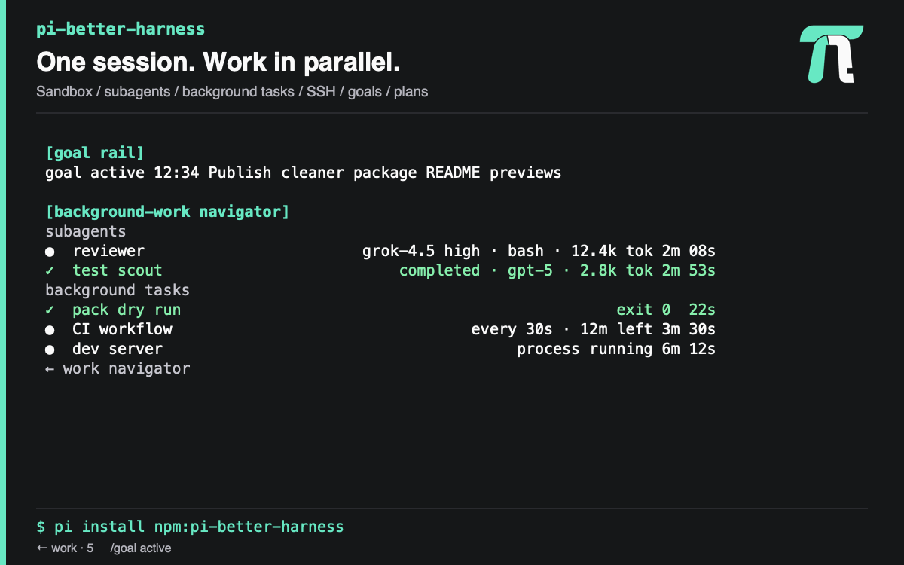
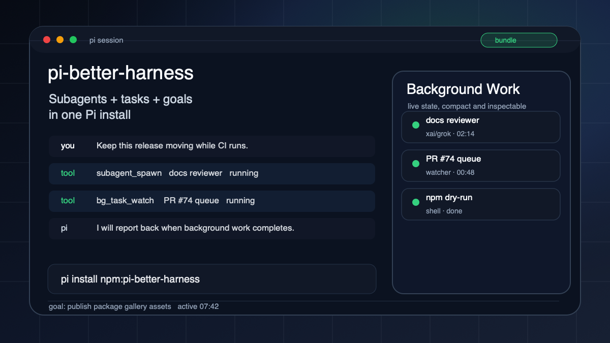

# pi-better-harness


`pi-better-harness` is a Pi meta package for an opt-in foreground write sandbox, delegated subagents, durable background tasks, synchronous SSH commands, goal tracking, and Goal & Todo.

## Quick Answer

Use `pi-better-harness` when you want the full working set for Pi. It manages:

- `pi-better-sandbox` for an opt-in write sandbox around Pi's foreground tools.
- `pi-better-subagents` for detached, sandboxed subagent runs.
- `pi-better-background-tasks` for durable shell tasks and watchers.
- `pi-better-ssh` for short remote commands over reusable SSH connections.
- `pi-better-goal` for explicit triggers, pause/resume, and background-aware continuation.
- Harness-owned Goal & Todo for session context and checklist progress. Saved work appears in the panel. Automatic Goal execution defaults to Off.

`pi-better-read-aloud` is intentionally not included yet.

<a id="outcome--todo"></a>
## Goal & Todo

The Goal records what the user wants to achieve. Its Todo lists the steps. The
panel shows checklist progress on the left and Goal status on the right. A
saved Goal has a **Start Goal** button. Click it or press **Alt+G** to start work
with the existing checklist. Use `/goal pause` to interrupt
foreground work and hold continuation. Both commands use the current Todo,
including checklists saved before a Goal was attached.

`/harness-settings` has one Goal setting, **Auto-start Goals** (default **Off**).
Turn it on to start a newly saved Goal with acceptance criteria, restart explicitly
reopened work, or bind a Goal when invoking `/skill:rush-issues` or
`/skill:resolve-issues`. Changing the switch takes effect on the next such action.
With it off, use `/goal resume` to start saved work manually.

The panel shows `goal saved` before execution starts and `goal active` with a
clock while it runs. Use `/todo` to reveal the panel and `/todo expand` to see
all steps. `get_todo` returns the full Goal and Todo, including acceptance criteria
and boundaries. Completing a step updates checklist progress. The Goal stays
open until its completion is recorded.

Use `update_todo({ goal: { objective, doneWhen, boundaries }, todo })` to save
work. Any of `doneWhen`, `boundaries` and `todo` may be omitted. Set
`newTask: true` for an unrelated task. Existing session records, settings and
clients using the legacy `outcome` field remain supported.

Todo uses the same workflow view for a bound task plan and a dynamic workflow.
The task list and diagram start at equal widths. Drag their divider in fullscreen Pi
or enter `/todo split 3:2` to give the task list three fifths of the available width.
The session remembers the ratio across reloads. Use `/todo split 1:1` to restore equal columns.
Below 36 terminal columns, the diagram follows the task list. Stage counts use the task symbols, so `Implement ●2` shows two tasks in progress. A pending stage shows `○`. In a mixed stage, `!1 ●2` shows one blocked task and two running.

Existing Plan session histories restore as Todo. Workflow task-plan files and
revision checks continue to govern workflow-owned plans. See the [usage guide](docs/usage.md#goal--todo).

### Dynamic workflows

Run `/dynamic-workflow` to plan the current task once. In `/harness-settings`,
**Automatic dynamic workflows (Beta)** defaults to **Off**. With **On**, Pi handles
simple requests directly and can plan a workflow for dependencies, role handoffs
or repeated review. Existing **Adaptive** settings are treated as **On**.
The command works with either setting and keeps your saved preference.

The agent records an objective, acceptance criteria, required outputs and task
dependencies. When the steps form a single chain in list order, the task list
uses the full width. Parallel branches, joins and review loops keep their
diagram as work progresses. The list uses full task titles. The diagram uses
short step or stage labels such as `Code review` and `UX review`.
Task icons distinguish ready (○), working (●), waiting (·), optional standby (–),
failed (×), and completed (✓) steps. In mouse-enabled Pi, click a task to highlight
its stage and inspect its latest result. Use `/todo expand` to show every task.
Independent tasks can run together. A join waits for each prerequisite's output.
If a reviewer requests changes, the revision opens and the revised artifact
returns to review. Delivery waits for approval of the current version.

The agent can select an inspected catalog role or named agent for a step.
The ordinary subagent launch applies the catalog skills and current permissions.
Harness associates the returned assignment and its verified result with the step.
Resume the session branch to continue from its saved outputs. A bound Goal also
requires evidence for its objective. A standalone workflow can finish on its own.

The separate **Project work ledger** setting enables a durable project-scoped
record of the overall outcome, boundaries, and high-level items. It stays off by
default; turning it off removes ledger views and hints without deleting records.
The same `update_todo` / `get_todo` interface carries optional ledger payloads and
selectors for create, update, attach, detach, list, and read. Updates require the
current revision, preserve completed evidence and history, and never associate old
work with a new session automatically. Use `/ledger attach <id>` (or an explicit
`update_todo` ledger attach) to continue the same record; `/ledger list`,
`/ledger switch`, and `/ledger detach` manage the reference without copying it. A
resumed session keeps its reference, a fresh session stays unassociated, and
bounded recovery reminders after compaction or resume are rebuilt from durable
state. Workflow-owned rows keep their canonical stage/status rendering; the
ledger adds context, not a second execution model. See
[usage](docs/usage.md#associate-a-ledger-with-a-session).

Subagent and background-task rows can be clicked to open their existing navigator
details. Enter and keyboard controls remain available, and editor input stays
passive. Harness packages do not write to Pi's status bar. Goal holds and resume
instructions remain available through `/goal`; permission checks are unchanged.

## Screenshots

<p></p>

## Install

Install the extensions as standalone Pi packages, so Pi displays and manages each by its own package name:

```sh
npx pi-better-harness install
```

For project-local Pi settings:

```sh
npx pi-better-harness install --local
```

The installer also registers Harness with filters for its own settings, minimal output, and Goal & Todo extensions. It removes an old `pi-better-plan` registration in the selected scope. The component packages keep their separate identities. Pi's normal installation prompts and errors still apply.

The single-bundle installation remains available:

```sh
pi install npm:pi-better-harness
```

To add model routing, run `pi install npm:pi-better-model-router` and select
`router/deepseek-flash-auto` in `/model`. The router package includes the Ollama
Cloud provider and requires Pi's `registerVirtualModel` API.

After a normal bundle install or `pi update`, Harness masks any separately loaded
`pi-better-plan` package before Pi registers its tools, `/plan` command, widgets,
or prompt hooks. This applies in either load order. The old registration and cached files may remain, but are inactive while
Harness is loaded. Settings and session history are not rewritten. The explicit
installer above removes the old registration in its selected scope instead.

## Ordinary Startup

You keep launching Pi the way you always have:

```sh
pi
```

The foreground write sandbox starts inactive. Use `/sandbox on` for the current
session or `/sandbox default on` to persist opt-in across startup, new session,
resume, fork, and reload. There is no launcher.

While it is on, Pi's built-in `bash`, `write`, and `edit` tools, your own `!` / `!!` commands, local background tasks, and subagents can write only under the directory you launched Pi from, minus the packaged deny paths (`.git/hooks`, `.env`, `.env.local`).

**Reads and network access are unrestricted** — this sandbox limits writes only. Writes are confined for those integrated first-party execution paths; Pi's own process, arbitrary `pi.exec` calls, and unrelated third-party extension code are **not** confined. Confinement is also **per surface**: each integrated surface denies its own control plane, not every other surface's, so with several first-party surfaces installed a confined process on one can still write another's control plane.

Sandbox state is human-only: `/sandbox`, `/sandbox on`, `/sandbox off`,
`/sandbox default on|off`, `/sandbox deny ...`, and `/sandbox rules` are slash
commands with no tool equivalent. `/sandbox off` and `/sandbox default off`
need interactive confirmation. Full policy: [pi-better-sandbox](https://github.com/1aboveio/pi-better-harness/tree/main/packages/pi-better-sandbox#readme).

## Minimal Tool Output

The bundled harness provides **Tool output** with **Normal** and **Compact** in
`/harness-settings`. `/tool-output minimal`, `/tool-output normal`, and
`/tool-output` (toggle) remain compatibility shortcuts to the same preference.
Minimal mode folds each tool call into a single-line header, including running
calls. The tool-specific icon and tool name share a state color: accent while
running, muted when completed, and error-colored when failed. In fullscreen Pi, a soft highlight travels through the entire visible running tool name and its
inline command/path details; details stay dim between highlight passes. Scrollback terminals keep static state colors.
Choose **Tool progress animation** set to **Off** in `/harness-settings` for static running headers.
Running and failed calls retain text labels so state never depends on color or
motion alone. Tool rows are indented two columns past
the assistant text padding. Long
headers are truncated to the terminal width; result bodies,
images, boxes, and tool spacers are hidden. Built-in, extension, and MCP calls
are included. Tools without a custom call renderer use a generic icon and a
compact argument hint. Compaction summaries also collapse to one quiet row with
the pre-compaction token count; Ctrl+O reveals their original summary.
Custom transcript messages from any extension also fold to a quiet disclosure
row with the message type and first content line. This includes background
completion batches and subagent health/timing alerts. Ctrl+O or a fullscreen
click reveals the original content and any custom renderer. Direct UI notices
are unchanged.
Execution, sandboxing, and agent-facing payloads are unchanged.
When a foreground run ends, each consecutive block of tool calls folds further
into one disclosure row showing the call count and any failures. Only the failure
count uses the error color; the disclosure and total stay muted. Assistant text
stays visible, and restored history uses the same folded view. In newer Pi
fullscreen mode, click a block disclosure to reveal its call rows, then click a
call to expand its original details. Hover highlights compact call and disclosure
rows using the selection background (reverse video for themes without one), and
tool icons sit centered in a three-column gutter. Click the disclosure again to refold the
block; native expanded call/result clicks collapse individual details. Regular
terminals keep mouse input for terminal selection and scrollback; Ctrl+O expands
all original tool details in both modes and folds them again on the next toggle.
`/tool-output normal` restores ordinary rendering. Error result bodies are also
hidden in minimal mode and remain available when expanded.

Minimal mode also covers Harness tools: Subagents, Background Tasks, Goal, Todo,
catalog inspection, and SSH. Compact calls retain the run or task ID, launch name
and task, background command, goal action, or plan summary without showing result
bodies. Finished calls fold into the same disclosure blocks as built-in tools;
expanding them restores their original package renderers. Goal and Todo widgets
and the background-work navigator are independent UI surfaces and remain visible.

Normal mode is the initial default. Changing tool output saves the choice in
global `settings.json` under `piBetterHarness.toolOutput`, as well as the current
session. New sessions inherit it; resumed branches retain their own saved choice.
This is a version-sensitive internal TUI adapter,
tested with Pi 0.82.1, 0.99.1, and the bundled Pi 1.0.4 CLI; incompatible APIs
produce a warning and leave ordinary output enabled. Print/RPC output and
exported transcripts are unchanged.

The installer includes this Harness-owned extension. To run it directly from a checkout:

```sh
pi -e ./packages/pi-better-harness/extensions/minimal-output/index.ts
```

## Harness Settings

Open `/harness-settings` to browse settings by function. Use the up and down
keys to move between settings. Each row shows its current value, a `›` for a
page, or **Edit…** for a prompt editor. Enter or Space activates the focused
row. Escape returns from a child page to the row that opened it.

**Agents & permissions** includes the settings pages of loaded Sandbox and
Subagents packages and the **Agent catalog** shortcut. Standalone installations
also provide `/sandbox`, `/subagents settings`, `/agents`, and `/goal settings`.

**Navigator layout** selects **Flat list** (the default) or **Tree**. Flatten keeps the Subagents
and Background Tasks groups and includes tasks launched by subagents. Tree puts
Main and subagents at the same level, with each agent's background tasks indented
beneath it. Switching applies immediately and saves `piBetterHarness.navigatorView`.
Worker-owned tasks expose status and logs; their execution remains managed by the
owning agent. Older worker tasks appear when a retained assignment wait proves
their parent, so unrelated sessions are never inferred from a reused conversation.

**Pin work panels** controls the shared navigator used by Goal & Todo,
Subagents, and Background Tasks. **On** (the default) keeps it above the input;
**Off** places it in the conversation so it scrolls with chat. Changes apply
immediately and save under `piBetterHarness.navigator` for future sessions.
Package controls and detail views remain available in either mode. Standalone
packages use the same shared navigator and saved preference.

The hub includes **Tool output** and **Tool progress animation** when the bundled renderer
extension is loaded. Changes apply immediately and save the default for future
sessions. The animation preference is stored in `piBetterHarness.toolAnimation`;
normal output and expanded tool details are never animated.
The hub also owns **Completion delivery**, shared by Subagents and Background
Tasks. Choose **When idle** (the default) or **During run**. Changes
apply immediately and autosave to the current session branch, including across
reloads. Press **Ctrl+S** to save the current choice as your default for future
Pi sessions; changing a session afterward does not change that saved default.
Saving a default leaves already-open sessions unchanged, including when
navigating to a branch without a session override.
The user default is stored in
`<agent-dir>/settings.json` under `piBetterHarness.callbacks` and also applies
when either callback package is loaded standalone. The former
`PI_BETTER_CALLBACK_WHILE_BUSY` environment variable is no longer supported.

All Harness-owned defaults use the `piBetterHarness` section of global
`~/.pi/agent/settings.json` (or `PI_CODING_AGENT_DIR/settings.json`): tool output,
Subagents configuration, callback delivery, Goal controls, and Sandbox activation,
permissions, and deny-rule templates. Existing preference files migrate on first
use after validation; global choices take precedence, and old files remain intact.
Updates preserve Pi's own settings and other packages' choices. SSH profiles,
plans, run records, and role/agent definitions remain in their existing stores:
they are session data or reusable definitions, not global UI defaults.
In `/agents`, model and effort edits are session-local until Ctrl+S saves them
to the user or trusted project's `agents/settings.json`. Markdown definitions
remain unchanged, so bundled prompt updates keep applying. The Settings,
Instructions, and Files tabs keep configuration separate from prompts.
**Reset to bundled** in Settings restores model/effort without changing the
prompt; in Instructions, it restores the prompt while preserving model/effort.
A user Markdown override is archived when its prompt is reset. Saved defaults
survive sessions and upgrades.

### OpenAI native compaction

Turn on **OpenAI native compaction** under **Recaps & instructions** in `/harness-settings` to use the provider’s native compressor for manual `/compact` and automatic compaction. The switch defaults to Off and applies to future compactions. It supports GPT models on OpenAI Responses and Codex Responses routes. If the standalone endpoint is unavailable, Harness tries the Responses compaction trigger. Routes without either capability use Pi’s summary.

Pi saves the complete compacted window in the session journal alongside the boundary of the recent messages it kept. Restarting before that write leaves the previous history available for retry. After the write, Pi can reopen the session and reuse the saved window. Switching to another route restores the original Pi history for that route.

The first request with a newly compacted prefix can be cold. Later turns reuse the same prefix, including across a restart. Cache hit rate depends on the length of the reusable input and the provider. To run the metered acceptance check, set `PI_NATIVE_COMPACTION_LIVE=1` and run `node --import tsx --test --test-name-pattern 'live GPT' packages/pi-better-harness/test/native-compaction.test.mjs` from the repository root with a configured `OPENAI_API_KEY`. The check reports each turn and requires more than 95% cached input on each of three warm follow-ups.

### Session recap

Enable **Session recap** in `/harness-settings` to add a one-line summary to the conversation transcript. The default is Off. Expand the entry with Pi’s expand-output shortcut to read the full text and any agreed next step. Saved recaps scroll with the conversation and reappear on their original branch.

Recap waits for the foreground turn and queued messages to settle and for the session’s background workers to drain. If a Goal exists, it must be paused or complete. A later pause or worker completion can produce the recap without another turn. Work that resumes during generation cancels the pending summary.

**Recap prompt** changes the instructions for the next summary. Clear the prompt to restore the default. Each recap uses a separate request to the answering model with bounded recent conversation text. Saved recaps stay outside the main model’s context. Generation requires a Pi host with configured model streaming and transcript entry renderers.

### Harness instructions

Open `/harness-settings` and toggle **Harness instructions** from **Off** to
**On**. Choose **Instructions prompt → Edit** to edit the current Markdown.
Saving updates the Harness block and stores the text in the global Pi settings
under `piBetterHarness.instructionsPrompt`. Turning the switch off removes the
block. Turning it back on restores the saved text. Changes apply on the next
startup or explicit `/reload`.

The CLI manages the same switch. To enable it from the command line:

```sh
npx pi-better-harness instructions enable
```

By default, Harness copies its bundled `AGENTS.md` into a marked block in
`<agent-dir>/APPEND_SYSTEM.md`. It preserves text outside the markers,
including blocks owned by other extensions. To use your own Markdown, set
`piBetterHarness.instructionsFile` in the global Pi `settings.json` to an
absolute path or a path relative to the agent directory (normally
`~/.pi/agent`), then run `instructions sync`. A prompt saved in the editor takes precedence
over this file. Remove `instructionsPrompt` and sync to use the file again.

| Command | Effect |
| --- | --- |
| `npx pi-better-harness instructions enable` | Create or refresh the block. |
| `npx pi-better-harness instructions sync` | Refresh an existing block after editing the source or changing its path. |
| `npx pi-better-harness instructions disable` | Remove the block and preserve the surrounding file. |

A global Harness CLI install refreshes an enabled block. A global CLI uninstall
removes it. If you remove the package directly with Pi, disable the block first.
Setting `instructionsFile` to `false` removes the block on the next sync.
The CLI stops on missing or duplicate delimiters in an existing block.
Keep other extensions' content outside the Harness markers.

Pi loads the file as a system prompt addendum. Ordinary turns and compaction
retain the loaded text. A new Pi process or an explicit `/reload` reads the
current file. Pi gives a trusted project's `.pi/APPEND_SYSTEM.md` precedence
over the global file. Explicit `--append-system-prompt` sources also take
precedence over automatic discovery.

Next-prompt inference is deferred pending safe public auth/header resolution in
Pi's SDK. It is not loaded by the bundle, has no toggle or preference store in
this version, and makes no auxiliary model requests. The integration blocker is
[issue #426](https://github.com/1aboveio/pi-better-harness/issues/426).

The hub is TUI-only and is included by the installer. To load the settings extension directly from the checkout:

```sh
pi -e ./packages/pi-better-harness/extensions/settings/index.ts
```

### Agent Supervisor

In `/harness-settings`, use **Supervisor scenarios** to choose which scenarios to run. **Supervisor mode** turns that selection on or off. You can edit the selection while the mode is off. First use starts with an empty selection. Settings apply to sessions sharing the Pi agent directory. Turning the mode off preserves the selection and lets existing tasks continue.

| Scenario | What the owner receives |
| --- | --- |
| CI observation recovery | A suggestion to resume observation of the original GitHub run when its local watcher exits and a fresh check confirms the run is active. Use `supervisor_consult` for the managed observer. |
| Diagnose stalled Goals | A diagnostic review after repeated identical successful repository reads return the same evidence throughout the stall interval. |
| Review Goal scope | A review of changed Todo steps against the latest user instruction and Goal. The owner chooses which steps to keep or prune. Use `supervisor_review` for an on-demand review. |
| Shared daemon fault diagnosis | A shared read-plane diagnosis with an owner-specific verification step when a runtime read fails and the daemon confirms degraded or rebuilding inventory. |
| Consolidate authorization requests | Owners in a trusted workspace can use `supervisor_request_decision` for the same proposal. The dialog shows the reference, operation, host, resource, side effect, workspace and validity period. Execution still needs the permissions normally required by the tool. |
| Follow up on recovery commitments | Use `supervisor_followup` to record the action, expected verification and actual tool results. Read progress with `/supervisor-followup`. Request one reminder with `/supervisor-followup remind <id> <minutes>`. |

## When To Use

Use the installer when you want every core extension with standalone package identities. Install an individual package instead when you only need the sandbox, subagents, shell task supervision, synchronous SSH, goal tracking, or model routing. Goal & Todo is available through Harness.

## Compatibility

| Requirement | Support |
|-------------|---------|
| Pi | Required |
| Recommended install | `npx pi-better-harness install` |
| Write sandbox on macOS | Seatbelt (`sandbox-exec`), ships with the OS |
| Write sandbox on Linux | Bubblewrap — install `bubblewrap` |
| Linked-worktree project context | A Pi host that applies `systemPromptOptions` after `before_agent_start` (Pi 1.x); older hosts keep the loaded prompt |
| Development runtime | Node.js 22+ |

## Update Or Remove

Remove every standalone package:

```sh
npx pi-better-harness uninstall
```

Add `--local` to remove them from project-local settings. This also removes the filtered Harness registration in that scope.

## More Detail

- Repository: https://github.com/1aboveio/pi-better-harness
- Detailed notes: https://github.com/1aboveio/pi-better-harness/blob/main/packages/pi-better-harness/docs/usage.md
- License: https://github.com/1aboveio/pi-better-harness/blob/main/LICENSE
