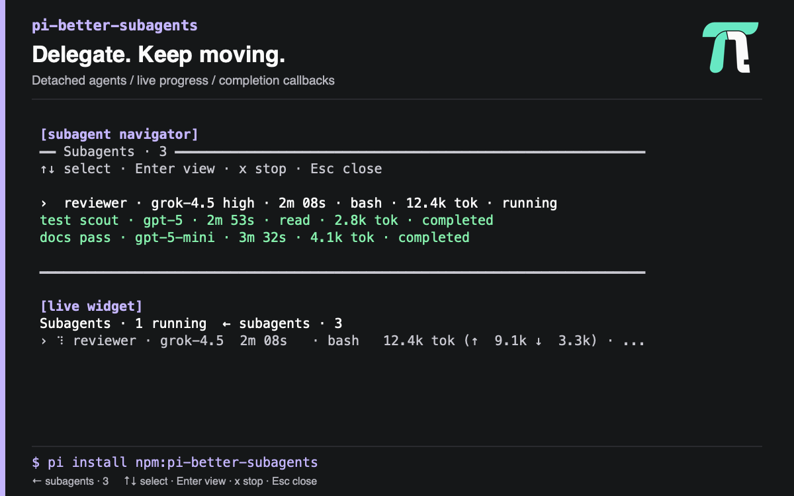
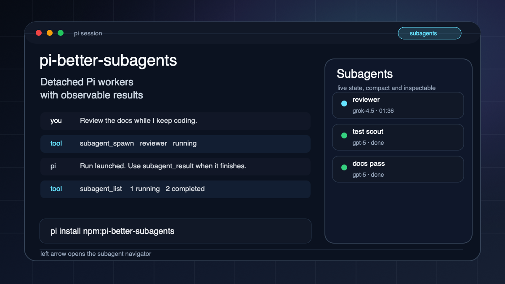

# pi-better-subagents

`pi-better-subagents` is a Pi extension for detached, optionally sandboxed subagent runs that keep the foreground Pi session free.

## Quick Answer

Use `pi-better-subagents` when you want Pi to launch independent agent work without blocking the current conversation. Each subagent runs in its own `pi -p` child process, reports back when finished, and keeps durable logs for later inspection.

## Screenshots

<p></p>

## Core Features
- Non-blocking subagent launches, with an optional role and named-agent catalog (`docs/agent-catalog.md`, `docs/agent-catalog-lifecycle.md`).
- Continue a saved conversation with `subagent_spawn({ session_id, prompt })`, or use `session_name` for a unique name in the current folder. Sessions persist by default. Lists show session IDs and search locally; `all:true` searches globally. Batch jobs use the same selectors. See [continuing a saved conversation](docs/usage.md#continuing-a-saved-conversation).
- Typed foreground `subagent_spawn_batch` launch receipts for native Pi codemode (Pi 0.99.1+), preserving direct tool calls, per-run callbacks, and batch capacity/catalog guarantees. See [codemode batch launches](docs/usage.md#codemode-batch-launches).
- Opt-in OS task sandboxing on macOS and Linux.
- Explicit tool allowlists for child sessions, and `skills` for prompt exposure: omit it to keep user-catalog discovery, pass `[]` for no skills, or pass absolute `SKILL.md` paths for exactly those. See [skill exposure](docs/usage.md#skill-exposure).
- Durable logs, result retrieval, and [failure observations](docs/failure-observations.md) independent of lifecycle status. A live child handles its own tool errors; the parent is woken only for actionable incidents, and children can classify handled failures with `failure_disposition`.
- Live background-work navigator for active runs.
- Harness-owned run timing: every run gets independent factual alerts for a tool call left open (5 min) and for no progress (10 min), plus a 60-minute hard timeout. Change the timeout in `/subagents settings`; `0` disables it. Soft deadlines remain opt-in. Configure per spawn with `deadline_minutes`, `grace_minutes`, `max_minutes`, `tool_wait_minutes`, `stuck_minutes`, globally in `config.json` / `PI_SUBAGENT_*_MINUTES`, or in `/subagents settings`. See [usage notes](docs/usage.md#run-timing-deadline-ceiling-tool-wait-stuck).

Every single or batch launch automatically joins one shared supervision watcher in the
foreground Pi process. The last active run's exit or stop tears it down; a later
launch starts it again. No separate background task or coordinator heartbeat is
needed. Completion delivery retries use the callback batcher's own timer. Lost-run
alerts retain supervision until their handoff is handled, so lost work is not silent.

## Worker Ownership

Every child launch, including clean, batch and unsandboxed launches, loads a Pi
hook that keeps external CI/PR monitoring with its coordinator. Workers finish
their assigned implementation or diagnosis, run focused checks, push only when
authorized, write the result, and return. Pending CI is a valid handoff, not a pass.

The hook refuses recognized `gh run watch`, `gh pr checks --watch`, and bundled
delivery-watcher commands through `bash` and `run_application`. Short status reads,
failed-log retrieval, and legitimate long local tests and builds remain allowed.
Workers retain ownership of their assigned validation. When Background Tasks is
loaded, default workers receive a guarded bridge to supervised local operations.
They launch a known long command with `bg_task_spawn`, continue independent work,
and call `wait_for_operations` when only the operation remains. The worker saves
the wait result and exits, releasing its capacity slot. Once the operation settles,
the same conversation resumes to read the evidence, acknowledge its interpretation,
and finish the assignment. A completed parked attempt does not complete the assignment.

When the guarded bridge is unavailable, workers hand back the exact command, cwd,
required environment variable names (never secret values), current evidence and
remaining validation. The coordinator runs the command through background tools
and inspects its terminal result. Shell polling and detachment are not substitutes.

Explicit tool exclusions and clean loadouts remain authoritative. The bridge does
not expand permissions: an operation must satisfy both the captured worker policy
and the current Background Tasks policy. Parking requires Pi SDK 0.82.1 or later,
a saved conversation, and a registered continuation adapter. If any prerequisite
cannot be proved, parking is refused or held with a reason.

The coordinator owns established command-only jobs and external delivery waits.
Use `watch_delivery` for supported merge observation. Recognized external watcher
commands remain refused in workers, including through their background bridge.
Command permissions and timeouts are unchanged.

## Install

```sh
pi install npm:pi-better-subagents
```

Try it for one run:

```sh
pi -e npm:pi-better-subagents
```

Sandboxing starts Off for fresh settings, including standalone subagents without published settings. Explicit saved profiles and session choices remain unchanged. Set `sandbox:true` for a confined launch; `sandbox:false` cannot bypass a human-enabled Subagents profile.

Linux confinement requires a usable `bubblewrap` backend and Pi SDK 0.82.1 or newer. `/sandbox` controls the independent Subagents profile, which each launch freezes. Pi handles its own startup, authentication, and provider connection; task tools obey the selected file, command, and network permissions. Outside project defaults to Write: tasks write across home and temp but can remove files outside the workspace only in temp, hidden home directories, and worktree folders (Linux keeps ordinary home folders read-only instead). Confined children admit `read`, `write`, `edit`, and policy-permitted `bash` or guarded `run_application`, the guarded `apply_patch` (Codex patches that follow the file rules), and the trusted tools ticked in `/sandbox` → Subagents · Tools (default `web_fetch` and `web_search`), which run outside the file rules. Other requested tools are reported as unavailable, with the reason. For direct applications without shell scripts, set Subagents → Sandbox On, Run applications On, Shell scripts Off, and Command time limit to 10 min in `/sandbox`, then press Ctrl+S. This is an explicit choice, not the default. New launches capture the policy; running children keep theirs. See [usage notes](https://github.com/1aboveio/pi-better-harness/blob/main/packages/pi-better-subagents/docs/usage.md#write-sandbox) for the runtime boundary and supported configurations.

## Delegation Modes

The user config sets `delegationMode` to `manual`, `adaptive` (default), or
`coordinator`. `/subagents settings` (or `/subagents`) opens a settings page
for delegation mode, the concurrent-subagent cap (default 6), the tool-wait
alert (default 5 minutes), the no-progress alert (default 10 minutes), and the
default skill exposure. The two time values are edited independently; `0` turns
one alert off. Skill exposure cycles between Discover automatically and No skill
catalog. The Selected skills row opens the same searchable checkbox picker used
by `/agents`: it lists loaded skills by name and description, Space toggles one,
Enter applies, and typing filters without dropping checked items. Saved paths
missing from discovery stay visible as unavailable and survive apply. Zero
checked applies No skill catalog, not discovery. Manual Add skill path remains
available. The page names whether the current value comes from the saved config
or this session. The session choice controls the next launch before Ctrl+S, and
edits persist across reloads. Ctrl+S saves mode, cap, timing alerts, and skill
exposure as defaults, and Reset to defaults clears session overrides, including
the skill list. Agents opens the same catalog as `/agents`; a definition that inherits
skill exposure shows whether the live value comes from this session, saved
config, or discovery, and an invalid draft is marked invalid rather than shown
as discovery. `/subagents mode manual|adaptive|coordinator`,
`/subagents cap <number>`, `/subagents tool-wait <minutes>`, and
`/subagents stuck <minutes>` are command equivalents; `/subagents save` persists
the current settings. Lowering the cap blocks new single and batch launches, including launches
still preparing, without stopping running work. Saved configuration changes are
picked up on subsequent reads; explicit session overrides still take precedence.
Before every model request, including continuations after tool calls,
the foreground receives one temporary settings block with the current mode, cap,
timing alerts, setting sources, revision, and running/reserved/available slots. The latest block
replaces older snapshots and delegation guidance; it is not saved as conversation
history. Changes reach the model at its next request, not during an in-flight
response, and are not broadcast to running children. The cap is a ceiling, not a
target number of agents. `subagent_settings` inspects the same effective state
without changing it. Its revision is a stable fingerprint of mode, cap, timing
alerts, and sources; occupancy changes do not change the revision. Admission rechecks capacity
when spawning because the snapshot can become stale.

The navigator's `main` row retains its mode-only controls:
`m` cycles the session mode, `ctrl+s` saves that default, and `x`
does not stop it. Manual delegates only on explicit user or workflow request, even with a
plan. Adaptive delegates substantial independent work when useful. Coordinator
uses `agents_catalog` to discover current role descriptions and delegates every
nontrivial role-owned task, while the foreground coordinates, integrates, and
verifies. See [usage notes](docs/usage.md#delegation-mode).

Saved defaults live in global `~/.pi/agent/settings.json` under
`piBetterHarness.subagents` (or under `PI_CODING_AGENT_DIR`) and survive package
reinstalls and upgrades. The old user config migrates on first use. Global values
override the package's `config.json`, which remains a compatibility fallback.
Save existing mode, cap, timing-alert, and skill choices with `/subagents save`
or Ctrl+S.
Discovery is saved as `defaultSkills: null`, which clears a previously saved
path list. Put other
custom config keys in `piBetterHarness.subagents` as well; edits made only inside
the installed package can be lost on upgrade.

`agents_catalog` shows each role's and named agent's default model and effort,
such as `role developer "Developer" … default openai/gpt-6.1-sol@high`. Roles are
listed and passed by short name (`role: "developer"`); the stored id
`role.developer` also works, and named agents keep their full id
(`agent: "agent.payments"`). To launch on that default, omit
`model` and `thinking` on a role or agent spawn; name one only for a stated
reason. When a launch's model or effort differs from the default, its launch
line says so, for example
`model openai/gpt-6-astra@high (role developer default openai/gpt-6.1-sol@high)`.

## When To Use

Skills can use the same role definitions on Pi and Codex through the standalone
`pi-agent-catalog` JSON CLI, without starting Pi. The CLI checks supplied host
capabilities and returns a worker plan; it never launches workers or substitutes
prompt text for model selection. See [shared worker catalog](docs/worker-catalog.md).

Use this package for independent coding, review, research, or verification work that can finish later. Do not use it for steps that need immediate foreground interaction or user clarification.

## Compatibility

| Requirement | Support |
|-------------|---------|
| Pi | Required for worker execution through this extension; not for standalone catalog planning |
| Install method | `pi install npm:pi-better-subagents` |
| macOS sandboxing | Supported when enabled |
| Linux sandboxing | Requires usable `bubblewrap` when enabled |
| Development runtime | Node.js 22+ |

## Update Or Remove

```sh
pi update npm:pi-better-subagents
pi remove npm:pi-better-subagents
```

## More Detail

### Assignment Progress

Result tools, lists, navigation and Goal activity share five assignment states:
Running, Waiting, Completed, Failed and Cancelled. Process status is separate.
An exited attempt can still be Waiting, and its output remains readable.
Consuming a dependency wait does not by itself complete the assignment.

The projection exposes an opaque semantic `revision`, readable `reason`, attempt
identity, process status, termination evidence and retained evidence references.
Compare revisions for equality; unchanged observations keep the same revision.
Unavailable or unsupported coordinator reads report Waiting with an unverified
reason. See the [projection contract](../../docs/adr/0022-assignment-progress-projection.md).

- Repository: https://github.com/1aboveio/pi-better-harness
- Detailed notes: https://github.com/1aboveio/pi-better-harness/blob/main/packages/pi-better-subagents/docs/usage.md
- License: https://github.com/1aboveio/pi-better-harness/blob/main/LICENSE
